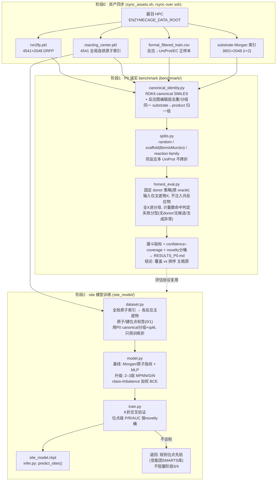

# ReactionAgent 设计文档（v3 · 位点驱动的神经-符号混合）

> 日期：2026-07-28（v3 取代 v2；v2 取代同日 v1）
> 范围：`CC/branch/ReactionAgent`（本地 LangChain/LangGraph 单 agent + 一个轻量可训练 site 模型）
> 目标：输入未知污染物底物 X → agent 从**多条**相似已知反应 A→B 归纳可迁移的转化概念，**先定位 X 上的反应位点**，再受约束地生成多步降解路径，并给出证据链；证据不足时**拒答**。
> v2→v3 的原因：即使 v2 加了"多视角检索 / 多尺度模板 / 证据融合"，骨干仍是 **Morgan 选 donor + DRFP 打分**——检索靠整分子相似度、生成靠"谁像抄谁的模板"、打分只有 DRFP 一个定量分。要真正跳出，必须引入**不依赖整分子相似度**的信号：**site-of-transformation 模型**（直接预测 X 上哪个原子/键反应，标签来自现成 `reacting_center.pkl`），并把检索主导权从 Morgan 转移到反应中心/转化/EC。

---

## 1. 目标与非目标

### 1.1 目标
- **P0 先行**：诚实端到端 benchmark，产出漏斗，定位瓶颈是"覆盖"还是"排序"。
- **site 模型（本期入场，需训练）**：轻量原子/键级反应位点预测器，标签来自 `reacting_center.pkl`（4541 条全局连续原子索引）；**不依赖整分子相似度**，直击"反应发生在哪个位点"的核心歧义。
- **去 Morgan/DRFP 中心化的检索与打分**：
  - 检索主导权交给**反应中心子图 + 转化指纹(A→B 编辑) + EC/酶家族**三路召回；Morgan 降为"全局骨架相似"的一个多样性视角。
  - 打分从"单 DRFP max"升级为**证据融合**：site 概率 + support consensus（多 donor 在**同一位点同一编辑**上一致）+ 酶家族密度(top-m 聚合) + 适用域惩罚；DRFP 退成诸特征之一。
- **增强版 agent**：本地 LangGraph 单 tool-calling agent（自由推理），LLM 编排确定性工具（含 site 模型），归纳转化族 + listwise 择优 + 拒答，输出多步路径 + 每步**证据卡**。

### 1.2 非目标（本期不做，架构留插槽）
- 不训练 listwise ranker（本期用规则/证据加权），不做 episodic 元学习 encoder。
- 不做 template-free Transformer 生成器、不接 EnzymeCAGE 3B 酶兼容性、不引入 EnzymeMap/ECREACT/enviPath 新数据层。
- 不做分支降解网络（v1 线性路径，架构预留树）。
- LLM 不直接生成产物 SMILES（避免幻觉、保价键守恒）。

---

## 2. 核心架构决策

| 决策点 | 结论 | 理由 |
|---|---|---|
| 顺序 | **诚实 benchmark（P0）先行**，再训 site 模型，再建 agent | 排序器再强救不回没生成的产物；先定位瓶颈 |
| 训练边界 | **只训练一个轻量 site 模型**（标签现成），其余训练-free | 最高杠杆、数据现成；控制工程量 |
| 反应位点 | **site-of-transformation 模型**预测原子/键反应概率 | 不靠整分子相似度，解"哪个位点反应" |
| 检索主导 | 反应中心子图 + 转化指纹 + EC/酶家族三路；**Morgan 降为多样性视角** | 去整分子相似度偏置 |
| 证据 | **多 support 证据集**（非单 donor），LLM 上下文归纳 prototype | 攻"选错 donor" |
| 生成 | **site 约束的多尺度模板 radius 0/1/2** + RDKit RunReactants | 位点先定，再迁移模板；攻 35% 覆盖 |
| 排序 | **证据融合**：site + consensus + 酶家族密度 + OOD 惩罚；**DRFP 仅为一特征** | 单 max-Tanimoto 易被偶然近邻抬高 |
| LLM 角色 | 编排大脑：模型/RDKit 出确定性信号，LLM 选择/归纳/择优/拒答 | 化学可追溯、零幻觉 |
| 兜底 | **拒答**（低证据/适用域外） | "有依据"= 完整可审计推理链 |
| 输出 | 多步线性路径（预留树）+ 每步**证据卡** | |
| 部署/框架 | 本地 · 数据同步本地 · LangChain(1.0)/LangGraph 单 agent | 不变 |

---

## 3. 潜变量推理骨架（LLM 的思考结构）

沿以下链条推理，使**错误可定位**：

```
X → 转化族 T → X 上反应位点 S → 局部图编辑 Δ → 候选产物 Y → 催化酶/EC E →(可选)环境 C
```

- 本期 **`S` 由 site 模型直接预测**（核心升级）；`T` 由多视角检索 + LLM 归纳；`Δ`/`Y` 由 site 约束的多尺度模板 + RDKit 生成；`E` 来自酶反查；`C` 留插槽。
- 证据卡按此链条组织，便于诊断（T 错=检索/分类；S 错=位点模型；Y 无效=化学约束；E 错=酶兼容性）。

---

## 4. Phase 0：诚实评估基准（先行交付物）

**目的**：把 `verify_substrate_retrieval.py` 的"条件排序"升级为端到端诚实评估，产出漏斗，定位瓶颈。

**必须修正**（逐条对应评审 §2/§10）：
1. **去 oracle donor 选择**：donor 不得依据"其候选是否含 Y_true"来挑；改为固定策略，所有结果照单计入。
2. **不使用 held-out 共反应物**：输入只有主底物 X；共反应物按未知处理。
3. **所有 X 进分母**：生成失败/无 donor/无候选都计入端到端分母。
4. **canonical reaction identity 去重**：canonicalize + 反应图编辑层去重；同一 substrate→product 同组；同一反应多 UniProt 不跨 train/test。
5. **命中判定收紧**：考虑计量数，避免 `issubset` 误判。
6. **错误谱系**：替换 `except: pass`，记录失败类型。

**产出漏斗**：可解析 → 有适用 donor/family → ≥1 候选 → generation recall@K → end-to-end top-1/3 → 高置信 selective 准确率；报 confidence–coverage 曲线。
**拆分**：random（sanity）+ scaffold split + reaction-family split（enzyme-cluster split 可选）。
**novelty 分桶**：按最近底物全局相似度 / 反应中心局部相似度 / 转化族频次分桶报告。
**验收**：得到端到端 top-1/3、逐阶段 recall、"覆盖 vs 排序"主瓶颈的明确结论。**同一协议后续复用于 site 模型与 agent 评估。**

---

## 5. Phase 1：site-of-transformation 模型（本期训练）

**定位**：本期唯一训练的模型，最高杠杆、标签现成、不依赖整分子相似度。

- **输入**：X 的分子图（RDKit → 原子/键特征；可选 transformation family 作条件）。
- **输出**：每个原子/键成为反应中心的概率。
- **标签**：`reacting_center.pkl`（4541 条全局连续原子索引）映射回各反应主底物的原子/键位点。
- **模型**：轻量 GNN（如 2–3 层 MPNN/GIN）或原子指纹 + MLP 基线先行；小数据下优先简单、可解释、易训。
- **用途**：① 约束模板应用位置（只在高概率位点迁移）；② 局部 donor 检索（按位点邻域匹配）；③ 候选排序特征；④ 证据卡可解释输出。
- **评估**：位点级 precision/recall/AUC，按 novelty 桶报告；接入 P0 同一拆分（scaffold / reaction-family split），**donor 库与标签只用训练折**。
- **风险控制**：数据量小（4541）→ 先跑基线、交叉验证、类别不平衡加权；若不达标则退回"规则位点先验 + 后续再训"，不阻塞 agent 主干。

---

## 6. Phase 2：Agent 架构

### 6.1 推理循环（LangGraph，自由推理）
```
输入 X
 ▼
每一跳 (current = X，之后 = 上一跳选定产物)：
 ① predict_sites(current)            → site 模型给原子/键反应概率（核心，去 Morgan 依赖）
 ② multi_view_retrieve(current, sites)→ 反应中心子图 + 转化指纹 + EC/酶家族三路召回，
                                         Morgan 作多样性视角；MMR 去近重复 → 多样化 support set
 ③ [LLM 归纳] 从 support set 抽象"共同转化 T"，形成假设（可多个）  ← 解 A
 ④ generate_candidates(support, current, sites) → **site 约束**的多尺度模板(0/1/2) RDKit 生成候选 Y'
 ⑤ collect_evidence(current, Y')     → 每候选汇集：site 概率、support consensus、酶家族密度(top-m)、
                                         适用域、酶/EC、DRFP(降为一特征)
 ⑥ [LLM listwise 择优 + 拒答]        → 综合证据挑本跳产物并写理由；证据不足→拒答  ← 解 B
 ⑦ [LLM 决策] 继续展开 / 停止
 ▼
输出：PathwayState（路径链 + 每步证据卡）；或 status=abstained
```
**停止条件**：矿化/终点 · 无候选 · 达深度上限（默认 5）· 最高证据分 < 阈值（默认 0.3，标注低可信/拒答）。

### 6.2 工具集（确定性，全本地）
| 工具 | 职责 | 底层来源 |
|---|---|---|
| `predict_sites(smiles)` | site 模型输出原子/键反应概率（**新，去 Morgan 核心**） | Phase 1 site 模型 |
| `multi_view_retrieve(smiles, sites, k)` | 反应中心子图 + 转化指纹 + EC/酶家族三路召回；Morgan 作多样性视角；MMR 去重；返回多样化 support set | `chenyu_features`（重构检索）+ `enzyme_lookup` |
| `generate_candidates(support_reactions, substrate, sites)` | **site 约束**下对每条 support 提多尺度模板 radius∈{0,1,2}，RDKit 生成候选，跨 support/尺度合并去重 | `pipeline`（扩多尺度 + site 约束）|
| `collect_evidence(substrate, candidates, enzymes, sites)` | 每候选汇集：site 概率、support consensus（同位点同编辑的独立 donor 数）、酶家族密度(top-m 聚合)、适用域标记、酶/EC、DRFP(一特征) | `reaction_scorer`（重构为证据融合）+ `enzyme_lookup` |
| `check_conservation(substrate, product)` | 价键/质量/元素/电荷守恒、碎裂过滤（进 LLM 择优前硬门） | 新增（RDKit 规则） |
| `is_terminal(smiles)` | 矿化/终点判断 | 新增（轻量规则） |

**设计原则**：工具返回结构化含证据字段的可读结果；反应中心分工遵循既有规范（MCS 中心用于模板迁移生成，chenyu 真值中心用于打分/训练 site 标签）；工具无副作用、可单测。

### 6.3 证据卡 / 状态
```python
@dataclass
class Evidence:
    transformation_hypothesis: str      # 转化族 T（LLM 归纳）
    site: str                           # 反应位点 S（site 模型）
    site_prob: float                    # 位点概率
    edit: str                           # 局部图编辑 Δ
    support_reactions: List[str]        # 多条支持 donor
    support_consensus: int              # 同位点同编辑的独立 donor/尺度数
    enzymes: List[Tuple[str, str]]      # [(uniprot, ec), ...]
    enzyme_family_density: float        # top-m 聚合的酶反应族密度（非单 max）
    drfp_score: float                   # DRFP 作为诸特征之一
    applicability: str                  # "in" | "borderline" | "out"
    counter_evidence: str               # 主要反证
    confidence: float                   # 证据加权近似（校准属桶3）
    llm_rationale: str

@dataclass
class Step:
    substrate: str
    product: str
    evidence: Evidence
    low_confidence: bool = False

@dataclass
class PathwayState:
    query: str
    steps: List[Step]
    status: str   # "completed_terminal"|"max_depth"|"dead_end"|"low_confidence_stop"|"abstained"
    funnel: dict  # 每步在漏斗各阶段的通过情况
    note: str = ""
```
**"有依据"= 完整可审计推理链**：转化族 + 位点(含概率) + 编辑 + 多 support donor + 多酶/EC + 适用域 + 反证 + 置信度 + LLM 理由；产物只由 RDKit 生成。

---

## 7. 目录结构（`CC/branch/ReactionAgent/`）
```
ReactionAgent/
├── benchmark/                 # P0 先行
│   ├── honest_eval.py         # 端到端诚实评估 + 漏斗 + 拆分 + novelty 分桶
│   ├── canonical_identity.py  # canonical 反应去重/分组
│   └── splits.py              # scaffold / reaction-family split
├── site_model/                # P1 本期训练
│   ├── dataset.py             # reacting_center.pkl → 原子/键位点标签
│   ├── model.py               # 轻量 GNN / 指纹+MLP 基线
│   ├── train.py               # 训练 + 交叉验证
│   └── infer.py               # predict_sites 推理封装
├── agent.py                   # LangGraph 单 agent + 循环 + 停止/拒答
├── tools.py                   # 6 个工具的 @tool 封装
├── prompts.py                 # 系统提示：潜变量骨架 + 归纳/择优/拒答指引
├── state.py                   # PathwayState / Step / Evidence
├── run.py                     # CLI 入口
├── sync_assets.sh             # 从晨羽 HPC 同步 data/
├── core/                      # 移植 + 重构 extract_rea_trans_fea
│   ├── chenyu_features.py     # 重构：反应中心/转化/EC 多路检索，Morgan 降为一视角
│   ├── pipeline.py            # + 多尺度模板 radius 0/1/2 + site 约束
│   ├── reaction_scorer.py     # 重构为证据融合（DRFP 降为一特征）
│   └── enzyme_lookup.py
├── data/                      # 本地资产（gitignore）
├── DESIGN.md                  # 本文件
├── PLAN.md                    # 实现计划
└── README.md
```
**桶3 插槽**（本期空实现/接口）：`tools.py` 预留 `learned_ranker_score` / `enzyme3d_compat` / `transformer_generate`；`Evidence` 字段已能容纳其输出。listwise ranker、episodic 元学习、template-free 生成器均留后续。

---

## 8. 可配置项

| 参数 | 默认 | 说明 |
|---|---|---|
| `max_depth` | 5 | 路径最大跳数 |
| `support_k` | 6 | support 证据集大小（MMR：反应中心2+转化2+远程类比1+反例1）|
| `template_radii` | [0,1,2] | 多尺度模板半径 |
| `site_top_n` | 3 | 每分子取前 N 个高概率位点 |
| `site_prob_min` | 0.3 | 位点概率阈值（低于不迁移模板）|
| `topm_family` | 5 | 酶反应族密度 top-m 聚合数（非单 max）|
| `confidence_threshold` | 0.3 | 低于此拒答/停止展开 |
| `branch_factor` | 1 | v1 线性；>1 长成分支树 |

---

## 9. 验证计划

- **P0 自身**：拆分上端到端 top-1/3、逐阶段 recall、confidence–coverage 曲线；给出"覆盖 vs 排序"结论。
- **site 模型**：位点级 precision/recall/AUC，按 novelty 桶；scaffold/family split，donor 库与标签只用训练折。
- **工具层单测**：site 约束多尺度模板对已知案例复现并扩大点火率；多视角检索/证据融合对比旧单 donor/单 max 的变化。
- **端到端 smoke**：辛醇 `CCCCCCCCO` 复现"借醇脱氢族 → 辛醛"，并能多步展开（辛醛→辛酸…）；构造库内无相近转化的 X 验证正确**拒答**。
- **诚实回归**：agent 端到端指标必须用 P0 诚实协议报告（不得回到 oracle donor / 偷共反应物）。
- **消融**：单 donor vs 多 support；固定 radius=1 vs 多尺度；有无 site 约束；单 max vs top-m 聚合；Morgan 主导 vs 反应中心/转化主导；无拒答 vs 有拒答。

---

## 10. 假设与风险

- **假设**：`rxn2fp.pkl` / `reacting_center.pkl` / 反应→酶映射可拷贝到本地；否则退回 HPC FastAPI 服务方案。
- **风险·site 数据量**：4541 条位点标签偏小 → 先跑基线 + 交叉验证 + 不平衡加权；不达标则退回规则位点先验，不阻塞 agent。
- **风险·覆盖**：site 约束多尺度模板若仍不足，P0 会暴露"覆盖为主瓶颈"→ 触发桶3 template-free 生成器（另立 plan）。
- **风险·LLM 发散/成本**：自由推理由 `max_depth` + 系统提示流程指引 + 工具幂等 + 每跳候选上限收敛。
- **风险·置信校准**：本期 `confidence` 用规则/证据加权近似；正式校准（temperature/isotonic/conformal）属桶3。
- **既有坑规避**：模板显式 H 伪影不点火问题已在 `pipeline._atom_query_smarts`（放宽 SMARTS）修复，移植/扩多尺度时保持。
- **诚实纪律**：任何对外汇报的判别力数字必须来自 P0 诚实协议，并标注 novelty 分桶。

---

## 11. 一句话研究命题

> 模型能否从动态检索的一组酶反应中归纳可迁移的生物转化概念，**在未知污染物上定位反应位点**，并生成经过证据链支撑、可拒答的产物假设？

---

## 附录 A：详细技术流程图

### A.0 图例与全局约定
- 数据资产（晨羽 HPC → 本地 `data/`）：`rxn2fp.pkl`（4541 条 DRFP，drfp 0.3.7，2048 维）、`reacting_center.pkl`（4541 条全局连续原子索引）、反应→酶映射 `formal_filtered_train.csv`、底物 Morgan 索引（3601 条，r=2/2048）。
- 反应中心分工规范（贯穿全图）：**MCS 反应中心 → 模板迁移生成**；**chenyu 真值反应中心 → 打分 / site 模型标签**。二者不混用。
- 关键默认参数：`support_k=6`、`template_radii={0,1,2}`、`site_top_n=3`、`site_prob_min=0.3`、`topm_family=5`、`confidence_threshold=0.3`、`max_depth=5`。

### A.1 离线：资产同步 + 诚实评估 + site 模型训练



### A.2 运行时：agent 逐跳推理（LangGraph 自由推理 ReAct）

```mermaid
flowchart TD
    IN["输入 X (SMILES)<br/>current := X"] --> NORM["RDKit 标准化<br/>SaltRemover 去盐 / 电荷中和<br/>互变异构 & 质子化归一<br/>MolFromSmiles→canonical"]
    NORM --> SITE["① predict_sites(current)<br/>site_model/infer.py<br/>输出: [(atom/bond_idx, prob)]<br/>不依赖整分子相似度"]
    SITE --> SF{"筛位点<br/>site_top_n=3<br/>prob ≥ site_prob_min=0.3"}
    SF -->|无高概率位点| ABST["status=abstained<br/>拒答: X 无可行反应位点"]

    SF -->|top-N 位点 S| RET["② multi_view_retrieve(current, S, k)"]
    subgraph RETV["多路召回 (Morgan 降为多样性视角)"]
        RET --> C1["通道1 反应中心子图匹配<br/>S 邻域子图 vs MCS中心库<br/>(主导)"]
        RET --> C2["通道2 转化指纹<br/>A→B bond-edit DRFP 检索"]
        RET --> C3["通道3 EC/酶家族<br/>formal_filtered_train 反查"]
        RET --> C4["通道4 全局 Morgan<br/>r=2/2048 (仅多样性)"]
        C1 & C2 & C3 & C4 --> MMR["MMR 去近重复<br/>support_k=6:<br/>2 反应中心 + 2 转化 +<br/>1 远程类比 + 1 反例"]
    end
    MMR --> SUP["support set<br/>[(A>>B, sim, uniprot, ec, center)]"]

    SUP --> LLM1["③ [LLM] 归纳转化族 T<br/>从多条 A→B 抽象共同编辑<br/>可产出多个假设 T1..Tn"]
    LLM1 --> GEN["④ generate_candidates(support, current, S)<br/>core/pipeline.py"]
    subgraph GENV["site 约束的多尺度模板迁移"]
        GEN --> T0["radius=0 泛化核心"]
        GEN --> T1["radius=1 邻域"]
        GEN --> T2["radius=2 官能团约束"]
        T0 & T1 & T2 --> APPLY["_atom_query_smarts 放宽SMARTS<br/>(元素+芳香+电荷+map, 防显式H不点火)<br/>RunReactants 仅在 S 位点迁移<br/>跨support/尺度合并去重"]
    end
    APPLY --> CAND["候选 Y' 集合<br/>canonical 去重"]

    CAND --> CONS["⑤ check_conservation(current, Y')<br/>硬门: 价键/芳香性 sanitize<br/>质量&元素守恒 / 电荷标准化<br/>碎裂过滤 / 显式小分子(H2O,NAD)记账"]
    CONS -->|全部不合法| DEAD["status=dead_end<br/>本跳无合法候选"]
    CONS -->|合法候选| EVID["⑥ collect_evidence(current, Y', enzymes, S)<br/>core/reaction_scorer.py"]

    subgraph EVIDV["证据融合 (DRFP 退为一特征)"]
        EVID --> E1["site 概率 (来自①)"]
        EVID --> E2["support consensus<br/>同位点同编辑的独立 donor 数"]
        EVID --> E3["酶家族密度<br/>top-m=5 聚合(非单max)"]
        EVID --> E4["适用域 in/borderline/out<br/>全局+局部+转化三层"]
        EVID --> E5["DRFP-酶集相似度<br/>drfp 0.3.7 现算, lru_cache"]
        E1 & E2 & E3 & E4 & E5 --> WSUM["证据加权 → confidence(近似)<br/>组装 Evidence 证据卡"]
    end

    WSUM --> LLM2{"⑦ [LLM] listwise 择优 + 拒答<br/>综合证据挑本跳产物<br/>写 rationale + 反证"}
    LLM2 -->|最高证据 < 0.3| LOWC["status=low_confidence_stop<br/>标注低可信/拒答"]
    LLM2 -->|选定产物 Y*| STEP["写入 Step: substrate→Y*<br/>+ Evidence 证据卡<br/>append PathwayState.steps"]

    STEP --> TERM{"⑧ 停止判定"}
    TERM -->|is_terminal(Y*) 矿化/终点| DONE["status=completed_terminal"]
    TERM -->|depth ≥ max_depth=5| MAXD["status=max_depth"]
    TERM -->|继续| LOOP["current := Y*<br/>下一跳"]
    LOOP --> SITE

    DONE & MAXD & LOWC & DEAD & ABST --> OUT["输出 PathwayState<br/>路径链 + 每步证据卡 + funnel<br/>run.py: JSON + 可读报告"]
```

### A.3 逐工具数据契约（具体技术细节）

| 步骤/工具 | 输入 | 输出 | 关键参数/实现 | 数据/来源 |
|---|---|---|---|---|
| RDKit 标准化 | X SMILES | canonical mol | SaltRemover、电荷中和、互变异构归一 | — |
| ① `predict_sites` | mol 图（原子/键特征） | `[(idx, prob)]` 原子&键 | GNN 2–3 层 MPNN/GIN 或 指纹+MLP；`site_top_n=3`、`site_prob_min=0.3` | `site_model.ckpt`（标签源 `reacting_center.pkl`）|
| ② `multi_view_retrieve` | current、位点 S、k | support set（≤6 条，含 A>>B/sim/uniprot/ec/center） | 4 通道召回 + MMR；配额 2+2+1+1；Morgan r=2/2048 仅多样性 | `rxn2fp.pkl`、转化指纹、`formal_filtered_train.csv`、Morgan 索引 |
| ③ LLM 归纳 T | support set | 转化族假设 T1..Tn + 位点映射 | 系统提示走潜变量骨架；不生成 SMILES | LLM（LLM_API_BASE_URL）|
| ④ `generate_candidates` | support、current、S | 候选 Y' 集合 | 多尺度 `radii={0,1,2}`；`_atom_query_smarts` 放宽 SMARTS；`RunReactants` 仅在 S 迁移 | `core/pipeline.py`（MCS 中心）|
| ⑤ `check_conservation` | current、Y' | 合法候选子集 + 记账 | sanitize、质量/元素/电荷守恒、碎裂过滤、显式小分子(H2O/NAD⁺)标注 | RDKit 规则 |
| ⑥ `collect_evidence` | current、Y'、enzymes、S | 每候选 `Evidence` | site prob + consensus + 酶家族密度 `topm=5` + 适用域 + DRFP(一特征，lru_cache) | `reaction_scorer.py`、`enzyme_lookup` |
| ⑦ LLM 择优/拒答 | 候选+证据卡列表 | Y* 或 拒答 + rationale | listwise 比较；`confidence_threshold=0.3` | LLM |
| ⑧ 停止判定 | Y*、depth | 状态机 | `is_terminal` 规则；`max_depth=5` | 轻量规则 |

### A.4 五种终止状态（对应 `PathwayState.status`）
- `completed_terminal`：到达矿化/终点分子。
- `max_depth`：达深度上限 5 跳。
- `low_confidence_stop`：最高证据分 < 0.3，标注低可信并停止展开。
- `dead_end`：本跳生成/守恒后无合法候选。
- `abstained`：无可行反应位点或全程证据不足 → 拒答（不强给产物）。
