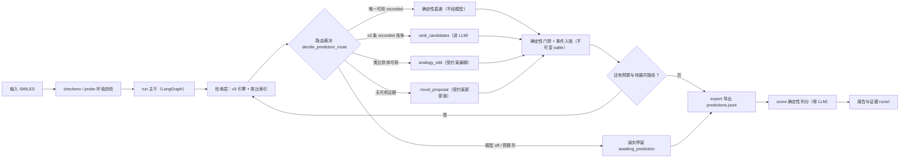

# dependingv43 — 酶催化污染物环境归趋路径预测与评测系统（v4.3 工作线）

> 面向半年后的自己和新的 AI 会话的自用导航。细节一律以被引用文件里的原文为准，
> 本文只负责指路；和正文冲突时，以 AGENTS.md 与各任务书为准。

## 这个仓库是什么

一句话：用 LLM（大模型）驱动的**酶催化污染物环境归趋路径预测系统**，外加一套
配套的**评测/判分体系**。给它一个污染物分子，系统检索已记录的酶反应证据、
必要时让模型提案，沿路径逐级展开，产出可审计的反应路径报告；再用确定性的
评测器（打分程序，全程不调用模型）对答卷判分。本仓是 v4.3 工作线，主线代号为
污染物路径 **ppv1**（S0–S5 分阶段推进，当前在 **S5b** 阶段），同期并行 HIT60
目标线（详见任务索引）。

## 快速上手

```sh
# 环境：本机 conda 环境 depending43（Python 3.11 + rdkit/lightgbm/numpy 等）
cd /Volumes/CC/Enzyme_Agent/dependingv43

# 跑全量测试（约数千项；slow 用例会真实加载 v3 引擎，明显更慢）
OMP_NUM_THREADS=1 /Users/cc/miniconda3/envs/depending43/bin/python -m pytest tests/ -v
# 只跑快速用例：在上面命令后加 -m "not slow"
# 包未 editable 安装时需前置 PYTHONPATH=src

# CLI 冒烟（资产自检 / 单分子探针 / 路径运行），见下节入口后按 --help 展开
/Users/cc/miniconda3/envs/depending43/bin/python -m pathway_v43 checkenv
```

CLI 入口统一是 `python -m pathway_v43`（子命令：`checkenv` / `probe` / `run` /
`resume` / `inspect` / `export` / `batch` / `score` 等）。路径依赖旁边的
`../dependingv3` 冻结引擎代码与本仓 `assets/` 反应检索资产（EAWAG/enviPath/USPTO
衍生数据，**许可未核实，仅限内部使用，不得公开分发**，见 ASSETS.md）。

## 工作流程

一句话链路：输入一个污染物分子的 SMILES（分子结构字符串）→ 检索已记录的
酶反应证据 → 按证据"能定就定、不能定才请模型"路由 → 反应事件入账（不可变
证据）→ 沿路径逐级展开 → 导出答卷 → 确定性判分（零 LLM）。

### 全链路一图



### 每步在干什么

- **输入与自检**：`checkenv` 校验资产清单、v3 引擎根与类比索引，任一不对
  直接报错（fail-closed，不猜）；`probe` 对单个分子冒烟检索，看能拿到什么
  候选。源码：`src/pathway_v43/__main__.py`、`src/pathway_v43/config.py`。
- **run 主干**：LangGraph 状态图驱动（节点幂等、每步落 checkpoint），支持
  `resume` 从检查点恢复与身份核对（代码/资产/策略变了会拒绝恢复）。
  源码：`src/pathway_v43/workflow/`（`graph.py` `nodes.py` `routing.py` `runner.py`）。
- **检索层**：包装旁边 dependingv3 仓的冻结检索引擎，加类比供体找回；
  每张证据卡都带实际来源文件与 SHA256，可逐卡审计。
  源码：`src/pathway_v43/services/reaction_finder.py`、`src/pathway_v43/adapters/v3_engine.py`。
- **路由裁决（系统的"思考"点）**：纯函数 `decide_prediction_route` 按证据
  定走向——只有一条可用已记录反应（recorded）时确定性直通、**不请模型**；
  多条 recorded 竞争时让模型在既有候选里裁决（rank）；类比供体可用时让模型
  做受约束编辑（analogy）；都没有才允许受约束新提案（novel），或按拒因
  诚实停留。模型关掉（`--model off`）或预算耗尽时停在 `awaiting_prediction`，
  绝不硬猜。源码：`src/pathway_v43/domain/policy.py`。
- **LLM 出网点**：全仓唯一的网络出口在 `src/pathway_v43/adapters/llm_client.py`，
  凭证只从环境变量读（模板见 `.env.example`），缺失即 fail-closed；
  `off` / `fake`（剧本假模型）两种模式全程零费用、零凭证。
- **事件入账与逐级展开**：反应事件单事务写 SQLite 账本，检索/预测产物写
  `results/<task_id>/*.json` 不可变证据（带哈希、防篡改）；展开预算以已落盘
  产物数为准，崩溃恢复不丢计数。源码：`src/pathway_v43/storage/`。
- **export 导出**：从已提交账本确定性导出 v3 冻结评测格式
  `runs/<run-id>/predictions.jsonl`（零 LLM），`--verify` 可核对导出新鲜度。
  源码：`src/pathway_v43/output/export_v3.py`。
- **score 判分**：只读调用 v3 冻结评测器（dev 切分），确定性程序、零 LLM；
  同评测器同切分的数字才可并列比较。源码：`src/pathway_v43/output/score_report.py`。

### 跑一遍看（catechol 示例，零费用）

用儿茶酚（catechol，`Oc1ccccc1O`，**非考题分子**，只当工作示例）从自检走到
判分。全程模型 off，不需要任何 LLM 凭证（命令实录出处：
`docs/CORE_WORKFLOW_REPORT.md` §4、`docs/EC298_PHASE_B_REPORT.md` §8）：

```sh
cd /Volumes/CC/Enzyme_Agent/dependingv43

# 1) 环境自检：资产清单/v3 引擎/类比索引，任一不对直接报错
python -m pathway_v43 checkenv

# 2) 单分子探针：看这个分子能检索到什么候选（输出候选与资产身份）
python -m pathway_v43 probe --smiles "Oc1ccccc1O" --top-k 10

# 3) 跑主干（模型 off；深度/展开预算给小值，烟测够用）
python -m pathway_v43 run --smiles 'Oc1ccccc1O' --run-id v43-smoke --max-depth 2 --max-expansions 3

# 4) 查看 run 状态与停止原因
python -m pathway_v43 inspect --run-id v43-smoke

# 5) 幂等恢复：已完成的 run 原样返回，计数不变
python -m pathway_v43 resume --run-id v43-smoke

# 6) 导出答卷（v3 冻结格式，零 LLM）
python -m pathway_v43 export --run-id v43-smoke

# 7) 确定性判分（零 LLM）
python -m pathway_v43 score --predictions runs/v43-smoke/predictions.jsonl \
    --out-dir runs/v43-smoke/eval --label v43-smoke
```

步骤 3 的真实行为（详见 `docs/CORE_WORKFLOW_REPORT.md` §4）：run 停在
`awaiting_prediction`——根分子检索到 101 张证据卡，其中有 3 条已记录反应
（recorded）互相竞争。模型关着没人裁决竞争，系统就诚实停在"待预测"，不硬猜、
不按分数偷偷淘汰候选；inspect 显示的 status 同为 awaiting_prediction。
步骤 6 导出的答卷如实反映"未提交任何反应事件"（off 模式没裁决就没有提交）；
步骤 7 的评分器只对 dev 题集里的路线计分，catechol 是题集外分子，判分结果
不构成任何成绩。

想零费用看到"模型裁决"一步的真实接线：`run` 支持 `--model fake --fake-script
剧本.json`（剧本假模型，参数定义见 `__main__.py`）；带真实资产的 catechol +
fake 全链路验收在 `tests/test_prediction_real.py`（3 条竞争 recorded →
rank_candidates → 选中卡经确定性门禁入账），过程见
`docs/PREDICTION_ATOMTOOL_REPORT.md` §0。

**想看真实 LLM 全链条**：见 `docs/EXPORT_DEV_REPORT.md` 与 `reports/export_dev/`
（真实模型 dev 批跑、冻结导出与对照报告）。声明：该报告属 dev 题域（B1 环境
路径中间步骤），数字不代表 298 题域，两个题域互不外推；具体结果数字见原报告，
本 README 不抄录任何跑分数字。

## 目录地图（关键入口）

| 入口 | 一句话说明 |
|---|---|
| `AGENTS.md` | 全仓工作约定（红线、评审-回修循环、返工教训），**AI 会话开工必读** |
| `docs/TASK_V43_HIT60_INDEX.md` | HIT60 主线任务书总索引：各任务状态、teacher 拍板、口径裁决 |
| `ARCHITECTURE.md` / `REPO_DESIGN.md` / `ASSETS.md` | 系统架构、仓库设计、数据资产与许可说明 |
| `docs/CHENYU_ACCESS.md` | 远端执行通道与路径说明（跑大批量任务的那台机器怎么连） |
| `docs/TASK_*.md`、`docs/POLLUTANT_PATHWAY_*` | 各阶段任务书、实施与评审报告（按主题+日期命名，找事先进这里） |
| `src/pathway_v43/` | 主代码包：`adapters/`（v3 引擎/类比索引接线）、`domain/`、`workflow/`（LangGraph 主干）、`storage/`、`exam*.py`（评测/判分）、`pollutant/`（ppv1 主线）、`batch.py`（批跑） |
| `tests/` | pytest 测试集（含 slow 标记的真实资产烟测） |
| `configs/` | 批跑配置与提示词模板 |
| `runs/`、`reports/` | 运行产物与阶段报告（`runs/` 与含金标的 reports 子目录已 gitignored） |

## 仓库红线（摘要，全文以 AGENTS.md 与 docs/ 为准）

- **金标（标准答案）永不入仓**：含金标的产物只放 gitignored 目录，绝不提交。
- **封存 run 只读**：历史实验产物不续跑、不改写；新实验一律开新的批次根。
- **判分零 LLM**：评测打分全靠确定性程序，判分链路里不允许调用任何模型。
- **对外数字必须带题域标签**：dev（开发集中间步骤）和 298（RHEA 通用酶学）
  是两个题域，两边数字不互相外推、不混着报。
- 另有 mimo 化学评审三触发点、评审-回修自动循环等流程约定，见 AGENTS.md
  对应章节；流程类结论采信到与程序证据互证的程度为止。

## 当前主线与远端

- 当前主线：污染物路径 **ppv1 S5b** 阶段（升级与复测轮，评审-回修循环推进中）；
  更早的 EC298 系列、HIT60 双轨口径等历史见 `docs/` 各报告与任务索引。
- 远端（git remote）说明：
  - `origin` = 组织仓（Water-Quality-Risk-Control-Engineering/depending），
    **只读拉取用**，对本仓会话严禁任何写操作（不 push、不改分支）；
  - `github` = 个人私有备份仓（NJUGongsai/pollutant-pathway），承载本仓
    v4.3 分支完整历史的镜像备份。
