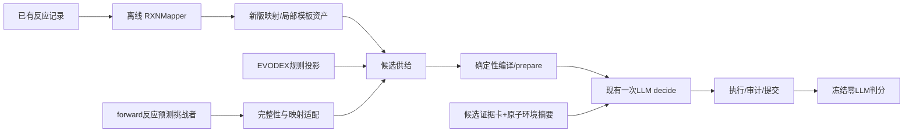

# 当前性能问题与开源模型/功能接入评估

日期：2026-10-14。对象：CC 点名的 dependingv43 根目录 PPV1；初始 HEAD `84a9eb4265805723f0305821c026e5e2f019f3f6`。内嵌 v44 只用于对照 RR A/B 聚合成绩。

本次请求是阅读代码和三份文档，判断问题与接入方向。附件里的“给 Claude 的任务”、旧阶段限制、实施要求与收益预测均作为待核材料，不自动作为本次执行指令。本报告没有启动实施、安装依赖、调用项目预测模型、重跑评测或修改冻结判据。只读核对源码、既有聚合 metrics/analysis 与公开官方资料；未读取参考图、金标结构或封存逐题 run，未向外发送本项目分子信息。新增本报告和任务书，保留原有工作树。

这里的“性能”以预测正确率为主；速度/费用单列。以下所有项目成绩均为 **298 / RHEA 通用酶学 / 已见题**，不能外推 dev 环境路径或独立盲测。

## 1. 结论与推荐顺序

**建议先补模型判断所需的信息与执行器缺失能力，再加外部候选供应。最明确能试的新增模型是离线 RXNMapper；最值得试的外部功能库是 EVODEX 的规则投影。RankLLM、REAP、OctoTools 整套并非当前优先项。**

| 优先级 | 加什么 | 放在哪里 | 为什么值得先做 |
|---|---|---|---|
| P0 | 候选证据卡：编辑变化、完整参与物角色、真实条件、来源与证明范围 | 现有一次 decide 模型调用的输入 | 代码已输出排列与编辑，但模型目前只见简化候选，很多判断依据没传进去 |
| P0 | RDKit 官能团/局部环境摘要；强模型同协议对照 | 现有底物执行图与 RealModelAdapter | 保留已经有贡献的 novel 生成，测“信息不够”与“模型能力不够”各自影响 |
| P1 | 离线 RXNMapper 新版模板资产 | 现有库记录 → 映射预处理 → 模板 → 共同编译器 | 把已存在却未充分利用的反应证据变成可执行候选；不占在线额外 LLM 轮次 |
| P1 | 共底物原子真正参与执行，先水/O₂两个有限家族 | recorded_source / compiler / AtomTool / production / audit | 当前能声明共底物，仍不能把它的原子并入主产物，属于真实能力缺口 |
| P1/P2 | 形式查询桥、立体比较/保持，再逐步扩电荷与立体编辑 | 检索与共同编译/执行链 | 处理酸/盐形式及真实构型信息；不把“统一写法”冒充化学正确 |
| P2 | EVODEX 规则投影侧路、受限局部反应模板 | 候选供给阶段 | 为全供体模板装不进底物的情况提供另一种可执行假设；仍走现有公共链 |
| P3 | 酶域 forward 反应预测挑战者；Chemformer forward 作通用基线 | 独立预测侧供给适配器 | 直接测新产物质量；权重、任务域、完整参与物和映射仍需解决 |

这些是实施优先级，不是收益承诺。前两项可先用现有模型和调用次数验证；共底物、立体/电荷属于协议与执行器工程，不能靠改提示词兑现。

## 2. 失分面到底是什么

主成绩已从 [metrics.json](/Volumes/CC/Enzyme_Agent/dependingv43/reports/ppv1_s5b/chain12_s5b_298_v4b_20261012/metrics.json) 直接核对：strict hit@1/@3/@5 = **92/126/130**，U=130；strict/partial/uncovered = **130/43/125**。旧口径同时披露为 **143/208/220**，两者差异来自尺子，不能当作性能增长。

| 面 | 聚合事实 | 工程含义 |
|---|---|---|
| 排序 | 38 题已有 strict 答案但不在第一位 | 可以改善第一名；仅重排当前已提交集合，上限130，不会创造新答案 |
| 参与物 | partial 43题，其中 superset 40、subset 3 | 要核完整参与物语义；不能删水/辅因子/副产物凑分 |
| 内容 | H桶120题；43题属于已有的表示/立体分类面 | 主产物内容和表示仍有缺口，排序不能单独救这些题 |
| 供给 | 空池/全败终局5题；大量题缺检索可执行候选 | 必须看 novel 的实际贡献，不能只看检索池吞吐 |

若只靠当前提交集合的重排，从92到119，需要将38个后位成功中的至少27个提到第一位，同时保住原来的92个成功。这相当于把覆盖题内首位成功率从 **70.8% 提到91.5%**，是很强的要求，不应仅靠换排列提示词承诺。130只约束这一个固定提交集合；更好的生成、编译或供给可以改变U。

### 2.1 新核验：生成已有明显贡献，不能关掉

本次只读汇总 [funnel_chain12_r2.json](/Volumes/CC/Enzyme_Agent/dependingv43/reports/ppv1_s5b/chain12_s5b_298_v4b_20261012/analysis/funnel_chain12_r2.json) 得到：

| 项目 | 汇总 |
|---|---:|
| 原统计 specs_raw | 5,498 |
| 保留的 pool_compiled | 182 |
| pool_compile_fail_total | 5,316 |
| novel_proposals（旧漏斗字段合计） | 1,378 |
| novel_rejections | 54 |
| events（全部事件统计，不等于root候选槽） | 1,478 |
| method_failed_productions | 21 |
| 130个strict覆盖题中，pool_compiled=0 | **57** |
| 92个hit@1题中，pool_compiled=0 | **42** |

`pool_compiled` 实际来自 manifest.pool_size，见 [统计脚本](/Volumes/CC/Enzyme_Agent/dependingv43/scripts/s5b_offline_funnel.py:100)。构建器把该池冻结进run输入，见 [builder](/Volumes/CC/Enzyme_Agent/dependingv43/src/pathway_v43/pollutant/s5b_builder.py:840)；root decide只读该池，再追加合法novel，见 [runflow](/Volumes/CC/Enzyme_Agent/dependingv43/src/pathway_v43/pollutant/runflow.py:868)。

**在manifest与run输入同源、普通生产链成立的前提下，57个覆盖成功和42个首位成功支持池外生成贡献的下界。** 本次没有逐事件重新归因，不能给出整个novel通道的准确命中率；但旧本地评审中“novel可能近乎无贡献，考虑关生成只排序”的默认方向已不合理。应保留生成，并增加零金标来源聚合。

旧漏斗的novel字段每题取最后一个scheduled outcome，并非整个run全部提案总数，见 [统计脚本](/Volumes/CC/Enzyme_Agent/dependingv43/scripts/s5b_offline_funnel.py:120)。该历史漏斗的 `network_request_count` 聚合为0，不能据此宣布原批零模型调用：它读取的旧字段并非实际请求账本的完整统计。请求数与费用须核 `model_requests/real_calls`，本次未重新核账。

### 2.2 “96.7%编译失败”需要订正量纲

5,498来自“幸存池大小＋失败记录”，不含成功编译后合并的53项。既有 [独立评审](/Volumes/CC/Enzyme_Agent/dependingv43/docs/S5B_CHAIN12_LOSS_ATTRIBUTION_ROUND1_REVIEW_2026-10-12.md:72) 已说明，当前provider确定性重放为 **5,551=5,316拒＋182保留＋53成功合并**，拒率95.77%。这是重放证据，不是旧批完整逐候选运行日志。

拒收还包含编译前必要条件过滤。no_alignment的3,113行中，2,497行为主反应物不适用，454行为共底物袋被拦；不能把所有拒收都视为编译器错误。原请求直方图“其他28”也少了6条，独立汇总应为 **34** 才闭合5,316。

“执行链四类终局失分桶为0”不等于所有候选都执行成功；本次聚合仍有21个method_failed production。需要分别报告候选失败、重试/替代成功与最终丢题。

## 3. 当前代码已经做了什么、真正还缺什么

### 3.1 第一项应该改：模型输入里的候选证据卡

当前 [runflow._call_real_fetch](/Volumes/CC/Enzyme_Agent/dependingv43/src/pathway_v43/pollutant/runflow.py:1272) 和 [build_proposals_user_payload](/Volumes/CC/Enzyme_Agent/dependingv43/src/pathway_v43/pollutant/real_model.py:212) 只传候选ID、主产物、coproducts和transformation_ref。底物已有原子图、形式电荷、H、手性和键表；[底物档案](/Volumes/CC/Enzyme_Agent/dependingv43/src/pathway_v43/pollutant/substrate_profile.py:48) 也已经生成，但真实调用未消费整个档案。

**具体增量：**建议新增纯函数 `candidate_evidence_payload`，从已经准备的spec/hypothesis抽取以下线上事实，接进同一次调用，不添第二个排序回合：

| 字段 | 用处 |
|---|---|
| edit_summary / reaction_center | 模型能比较改变了哪条键、哪种官能团；原子ID仍以执行图为准 |
| participants / roles / stoichiometry | 区分主产物、副产物、辅因子，避免只比较主产物字符串 |
| alignment_status / representation_fidelity | 披露映射、构型和形式的不确定性 |
| known_conditions / source_refs / proof_scope | 告诉模型实际证据支持到哪；缺失写unknown，不能从题卷答案补信息 |

在现执行图上增加RDKit官能团、局部环境、反应中心文字摘要即可先试。Gasteiger电荷是计算描述符，不能当作确定的酶攻击位点。先比较信息增量，再比较不同模型；RR扩容失败不能证明更强模型一定无效。

同时检查排序契约：[model_protocol](/Volumes/CC/Enzyme_Agent/dependingv43/src/pathway_v43/pollutant/model_protocol.py:222) 已接受ID排列，但未把完整、唯一排列作为强约束。新增模式中按合法候选集验重、验缺失、验未知ID；不完整则整体回退既有完整顺序。现有联合协议允许选择子集，不能无版本区分地把历史合法行为全部改判错误。

### 3.2 共底物：缺的是执行图里的原子来源

[recorded_source](/Volumes/CC/Enzyme_Agent/dependingv43/src/pathway_v43/pollutant/recorded_source.py:933) 已支持D2声明与独立产物组分拷贝，不能再建议“加共底物字段”。真实限制是A、B原子键合成同一产物仍拒；[production](/Volumes/CC/Enzyme_Agent/dependingv43/src/pathway_v43/pollutant/production.py:832) 仅渲染主底物执行图。

建议先做“主底物＋一个已知共底物”的联合执行图，给原子保留不同来源命名空间，完整记录反应两侧。先以有可追溯记录的水解/水合、氧插入为小范围正控；缺来源、歧义映射与不守恒保持拒绝。不能只放宽 [builder元素门](/Volumes/CC/Enzyme_Agent/dependingv43/src/pathway_v43/pollutant/s5b_builder.py:637)，或靠add_atom凭空补氧。

454行触及167题是诊断触达面，不是167个可翻对题；984个键合贡献拒收与这454行是两种不同原因，也不能相加成题级收益。独立辅因子对/独立H₂O₂的诚实记录有些已可由D2表达，不应全部归入新执行图收益。

### 3.3 局部模板：应另建受限通道

现analog先按Morgan相似度召回，S5b共同编译器要求整个供体落在当前底物上，见 [完整供体对齐](/Volumes/CC/Enzyme_Agent/dependingv43/src/pathway_v43/pollutant/s5b_compiler.py:487)。服务层虽有中心回退，生产builder没有消费它，见 [analog_source](/Volumes/CC/Enzyme_Agent/dependingv43/src/pathway_v43/services/analog_source.py:415)。

可离线从完整映射反应抽取“全部变化端点＋有限半径上下文”，保存全记录、离去组分和共底物来源，再建立小规模局部模板供给。验收边界键、芳香环、多个落位、完整产物与参与物，不是一行改成center_only。2,497条不适用完整供体也不证明其全部反应中心一定适用；应另测，不能直接给收益数。

### 3.4 形式、电荷与立体：分别处理

| 项目 | 真实缺口与方案 |
|---|---|
| 酸/盐形式 | CN已中和电荷用于检索，而编译仍匹配原结构。先加查询形式桥并保留回到raw结构的原子对应；不能覆盖原ChemicalState |
| 互变异构 | 可增加生成侧有来源、可执行的形式候选；不能改strict身份或统一标准答案来宣称预测提升 |
| 立体保持/变化 | 先统一映射配体比较，再补创建/反转。compiler比较raw ChiralTag不能完整代表真实构型保持；audit已有映射邻居排列思路可抽共用helper |
| E/Z | 当前键差主要比较bond order；需单列几何立体表示/执行与核对，不能认为134条stereo拒因囊括全部问题 |
| 电荷变化 | AtomTool缺显式属性编辑，需与H、质子供体/受体和电荷来源一起版本化，不是只加set_formal_charge |

代码依据：[compiler变化判定](/Volumes/CC/Enzyme_Agent/dependingv43/src/pathway_v43/pollutant/s5b_compiler.py:472)、[已有立体审计](/Volumes/CC/Enzyme_Agent/dependingv43/src/pathway_v43/pollutant/audit.py:2117)、[AtomTool操作集](/Volumes/CC/Enzyme_Agent/dependingv43/src/pathway_v43/services/atom_tool.py:71)。现有碳中心的有限手性消解与显式氢墙已经做过，不能重复计收益；非碳中心不能外推。新增能力应共同覆盖parse、prepare、execute、target对账、audit及replay。

已有形式实验为82行中恢复对齐64行，最终10行/7题产生编译候选；恢复对齐不等于翻对7题，更不等于收回全部20个表示类错题。来源：[form_norm_experiment_data](/Volumes/CC/Enzyme_Agent/dependingv43/reports/ppv1_s5b/chain12_s5b_298_v4b_20261012/analysis/form_norm_experiment_data.json)。

## 4. 两份侦察报告，哪些能拿来用

“可复用”分成能使用发布代码/模型、需要适配的数据、只借设计思想，不能把下载成功当作已经接通。

### 4.1 LLM协议层

| 资源 | 可取部分 | 当前结论 / 官方依据 |
|---|---|---|
| RankLLM | 比较提示、位置偏置检查、排列校验 | 已有rank_hypotheses排列，先借方法做小A/B。其IR收益不能折算化学题；[官方仓库](https://github.com/castorini/rank_llm) |
| REAP | 原子环境/先验文本化思路 | 整套包含GIN图网络、VQ、预训练AtomDisc与三阶段RAG，任务为分子性质；不是纯RDKit卡片。先自写增量；[官方方法](https://github.com/mingxuZhang2/REAP#-methodology)、[论文](https://aclanthology.org/2026.findings-acl.97/) |
| Instructor | schema与字段/ID校验 | MIT，可选小范围使用；现有解析/有界格式反馈已存在。不能默认自动化学重试增加调用；[官方说明](https://github.com/567-labs/instructor) |
| XGrammar | 服务端受约束解码 | 若端点/推理栈支持再接。只保证声明文法，不保证化学正确或seed完全复现；[官方说明](https://github.com/mlc-ai/xgrammar#overview) |
| OctoTools | 工具卡和能力披露 | 已有编辑序列、AtomTool预检/执行/审计，多数功能重复；暂不引入第二套planner循环；[官方架构](https://github.com/OctoTools/OctoTools#introduction) |
| semantic_uncertainty | 后续多采样研究思路 | QA研究代码、需额外采样；当前许可BSD-3-Clause-Clear，旧文MIT需改。主产物投票不能替代完整反应聚类；[官方仓库](https://github.com/jlko/semantic_uncertainty) |

RankLLM还有具体接线问题：[当前RankGPT实现](https://raw.githubusercontent.com/castorini/rank_llm/main/src/rank_llm/rerank/listwise/rank_gpt.py) 使用responses.create，异常循环未限定总次数；本项目用现客户端的有限重试与记账。先复用项目调用层，不把整套API调用层直接替换进去。公开main只代表查阅时状态，正式依赖应固定commit。

不优先PydanticAI/deepagents/MCP-RDKit全栈重构：当前有确定性主干与本地RDKit，新增框架本身不能解决反应内容、原子来源或立体表达缺口。ChemBench可做外部能力锚点，不能代替本任务冻结评测；SEP依赖模型内部访问/额外组件，当前缺直接接入证据。

### 4.2 语料与规则

| 资源 | 发布物 / 核验订正 | 适合怎么接 |
|---|---|---|
| **EVODEX** | MIT代码及规则/投影API；稳定2.1.0，2.1.1撤回。旧“8.3万EnzymeMap+ECREACT合并”不是当前版本可靠口径 | 优先小规模侧路：投影完整产物组，转本仓假设，再编译/执行/审计；[官方仓库](https://github.com/UCB-BioE-Anderson-Lab/EVODEX)、[2.1.0](https://pypi.org/project/evodex/2.1.0/) |
| **BioRGroup** | 12,709是全部唯一ChEBI/SMILES，含R为2,124；提供分子匹配CSV，未提供确认的具体反应对。代码MIT、数据Etalab2.0 | concrete→generic ChEBI召回侧表；跨反应两侧一致实例化另验，不做笛卡尔配对；[论文](https://www.nature.com/articles/s41597-025-05983-w)、[代码](https://github.com/brsynth/biorgroup)、[数据](https://doi.org/10.57745/V3URYA) |
| **ECREACT** | 62,222是唯一反应–EC组合；官方CSV示例无原子map，论文有共酶/副产物删除、单产物过滤。仓库MIT不证明完整参与物已保留 | 数据/训练参考或酶域forward支线，先核验实际文件schema与完整性，不能直接宣称是完整映射反应库；[仓库](https://github.com/rxn4chemistry/biocatalysis-model)、[论文](https://www.nature.com/articles/s41467-022-28536-w) |
| **ReactZyme** | 酶序列–反应配对与切分，仓库CC0、Zenodo数据MIT；不是底物→产物即用预测器 | 有酶序列/真实酶上下文后再用于条件检索；当前底物输入下后置；[仓库](https://github.com/WillHua127/ReactZyme)、[数据](https://zenodo.org/records/13635807) |
| ModelSEED | 多源代谢资源，需ID与结构/来源适配 | 两个题域都不先盲目全量加入；先统计可新增的完整可执行反应 |
| 文献挖掘/环境专项库 | MERMaid/MERMES、mibPOPdb、漆酶基准等 | 适合未来环境域取证和独立评测；本次未逐项重新核验，不能按旧数字当即用反应对 |

EVODEX尤其要保留产物元组：其 [便捷投影代码](https://github.com/UCB-BioE-Anderson-Lab/EVODEX/blob/main/evodex/synthesis.py) 有逐组分展平输出路径，不能直接当完整净反应事件。局部规则命中只代表可推导假设，不能升级成实验记录或完整机制证明。

旧文“BRENDA衍生必然禁商用”也需订正：[当前BRENDA官方数据许可](https://brenda-enzymes.org/license.php) 为CC BY4.0。应逐项登记具体历史数据快照、规则数据和其他上游条款；不能用仓库MIT替所有数据背书，也不能由BRENDA血统直接套用其他库的NC-SA。

对298已见题，优先看**已有证据的可执行性与独特新反应覆盖**；对未来盲测，再考虑数据源多样性、环境域比例与真实条件。RR一个负实验不能证明所有新数据无效，也不能证明新模型无效。所有新库均应做来源/反应/结构重叠审计；源于RHEA的训练或检索增量只能按证据覆盖重建报告，不能宣称独立泛化。

## 5. 明确回答“加什么模型，在哪加”

### 5.1 首选新增模型：RXNMapper，离线补已知反应映射

[RXNMapper](https://github.com/rxn4chemistry/rxnmapper) 发布MIT代码和可本地用的ALBERT权重，输入完整反应两侧、输出映射反应与confidence。**它需要已有产物，不能只给底物让它预测新产物。**

具体落点：独立资产构建脚本 → 新版模板manifest → AnalogSourceResolver → [compile_donor_template](/Volumes/CC/Enzyme_Agent/dependingv43/src/pathway_v43/pollutant/s5b_compiler.py:884)。现recorded/corpus已有确定性 [infer_reaction_mapping](/Volumes/CC/Enzyme_Agent/dependingv43/src/pathway_v43/pollutant/recorded_source.py:728)，RXNMapper可用于离线补充/对照，不能悄悄放进在线编译。

本仓已有 [样本探针](/Volumes/CC/Enzyme_Agent/dependingv43/reports/ppv1_s5b/chain12_s5b_298_v4b_20261012/analysis/rxnmapper_validation.md)：1,000个RHEA输入映射成功967、机械QC953，属于工具可用性证据，不是95.3%化学映射正确率或hit收益。实施时固定模型版本、完整反应、映射与规则文件hash；验元素/双射/变化中心、保留歧义与来源。模型confidence不是经校准的反应正确概率。它也不会修好2,497个主供体本来不适用的no_alignment。

### 5.2 新产物模型：酶域forward为目标，通用forward为对照

ECREACT/biocatalysis-model方向更贴酶学，但官方预训练入口是IBM RXN平台/API，本次未核到可直接下载的酶域本地checkpoint。不能把它写成“pip安装就能预测”。EC3模型还需要EC条件：只用线上已知EC，或把检索EC作为明确标注的假设；不能偷用评测答案的EC。无条件EC0是另一个训练方案，不能删掉EC3输入token冒充EC0。

[Chemformer](https://github.com/MolecularAI/Chemformer) 有forward与公开模型入口，项目现已迁向 [AiZynthModels](https://github.com/MolecularAI/aizynthmodels)；当前 [LICENSE](https://github.com/MolecularAI/Chemformer/blob/main/LICENSE) 是Apache2.0，README尾部MIT说法已不一致。它适合先作可获得的通用forward基线，但输出产物SMILES，不自带本仓原子映射编辑/完整参与物/证据契约，有机合成域的成绩不能预支到酶学。

预测输出须过完整产品假设适配、映射、编译、执行与审计。预测来源仍是预测，不能伪装成recorded证据；若来源不满足准入，只作提名/unknown，不降低门禁。离线运行也仍是新增模型推理，需计入算力、版本与实验成本。

**LocalRetro不选作这一主线。** [官方仓库](https://github.com/kaist-amsg/LocalRetro) 为逆合成，现许可CC BY-NC-SA4.0。Graph2Edits等也要先核方向与权重，不能因为名字含“编辑”就当正向酶反应模型。

### 5.3 更强LLM是否值得换

可以直接在现RealModelAdapter下做同协议挑战者，无须重建全框架。先增强输入，再固定同候选、提示、生成上限、调用数和费用帽比较现模型与备选模型。重点看**新增严格成功减旧成功退步，以及每个净新增成功的成本**。没有实验能证明“更强一定有效”，也没有现证据能证明“更强完全无效”。本次未核不同商用模型价格/能力，不指定付费型号或作采购结论。

## 6. 最小验证序列与停止条件

| 顺序 | 实验 | 对照与验收 |
|---|---|---|
| 0 | 来源归因与能力清单 | 只出novel/pool覆盖、编辑能力、真实EC/条件可用率等聚合；给生成贡献精确账 |
| 1 | 候选证据卡＋原子摘要 | 同模型/供给/单次调用，A现输入/B新增事实；保留novel，报告U、hit@1/5、完整准入与费用 |
| 2 | 强模型/排序提示支线 | 与信息增量分开；固定候选诊断排序、正式新批核联合生成；另做反向输入位置敏感性 |
| 3 | 离线映射小pilot | 固定既有记录，旧映射对照RXNMapper；先测独特可执行反应、歧义与全产物复现，再测命中 |
| 4 | 共底物真执行与立体有限扩展 | 合成正负控先覆盖全入口；新批按来源家族核结构改善、partial和strict，不能以删参与物通过 |
| 5 | EVODEX/局部模板/forward支线 | 一次只开一项；候选预算、超时、截断和fallback明确；原成功退步一并报告 |

正式评测用新批次与预登记配置，保持原尺子；多个独立重复批或受支持seed看稳定性，不能把单批+1～5题当稳定收益。298含重复底物，置信区间宜按底物组聚类，避免把重复题当独立证据；不把“固定seed”当作API完全确定性保证。探针看过的298只能用于工程诊断，最终泛化应有来源隔离的独立盲测。

现 [criteria-v2聚合对照](/Volumes/CC/Enzyme_Agent/dependingv43/reports/ppv1_s5b/chain12_s5b_298_v4b_20261012/analysis/criteria_v2_rescore_data.json) 仍解锁0，文档13题是待声明链兑现的模拟面。可以另做生成侧声明链激活；v1与v2并列披露，不把判分口径变化当作模型多预测对13题，也不能把40个superset都纳入窄豁免族。

旧评审还有三类不能采信的推断：下游depth deferral不证明参考需要多次酶反应；多个原子编辑也不等于多步路径。自由基曾不命中不能证明未来一律禁止自由基“零风险”。候选与参考参与物不同，也不能单凭subset标签认定守恒审计漏洞。发现具体契约反例再修，避免围绕金标做特例。

## 7. 如果“性能”也包括速度和费用

没有本次独立时延profile，因此以下是优化候选，不声称已经提速：

| 功能 | 具体落点 | 作用与限制 |
|---|---|---|
| 确定性检索池缓存 | builder逐题provider外层 | 以严格底物、全部检索/编译配置和资产hash为键，保存完整诊断；重复底物复用计算，不能只用立体盲CN键 |
| 更早的主供体适用性筛选 | analog召回层 | 减少明显不适用供体的昂贵对齐；重新取足可用候选，不能只过滤后留空。速度改善与命中改善分开测 |
| 官能团/执行图缓存 | 同底物纯函数构造 | 缓存版本化计算描述符，不复用不同条件或原子编号下的编辑 |
| 时延分段统计 | build、映射、LLM、execute/audit | 报p50/p95、token、真实请求账和截断；先知道耗时在哪里，再调并行/枚举预算 |

按稳定request_id保存、校验并恢复响应blob的能力已有，见 [real_model](/Volumes/CC/Enzyme_Agent/dependingv43/src/pathway_v43/pollutant/real_model.py:573)。新增的是跨题确定性池缓存，不应泛称“当前没有缓存”。冻结批次默认保留逐题模型调用独立性，不能顺便把不同题的随机模型结果共享后当同一评测。

**建议下一份实施任务聚焦三件事：候选证据卡、生成贡献聚合、离线RXNMapper小pilot。** 结果再决定共底物/立体工程与EVODEX投入，避免一次堆入五个项目后无法归因。
