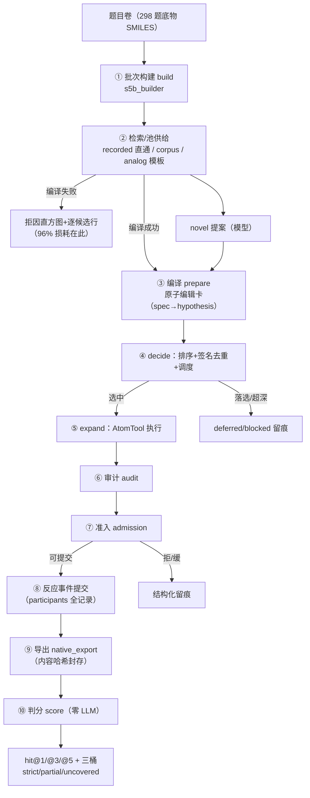

# PPV1 污染物降解路径预测系统 · 整体介绍

> 2026-10-12 出品。分层设计：**§1 大白话速览**（零基础可读，5 分钟）；**§2–§3 系统结构与节点详解**（工程细节，带文件坐标）；**§4 合成案例全链走读**（每个节点的真实输出）；**§5 成绩口径与边界**；**§6 名词表**。
> 本文读者：老板/外行读 §1+§5；新协作者/代理读 §2–§4。案例为合成案例真跑（零模型段），不涉 298 题面与金标。

---

## 1. 一页大白话：这套系统在干什么

**一句话：给它一个污染物分子，它回答"酶会把这个人变成什么"，然后像考试交卷一样按严格标准判分。**

把它想成一个**开卷考试的研究生团队**：

- **考题**：一张卷子 298 道题（RHEA 通用酶学题域），每道题就一句话——"这个底物分子，经过酶催化会变成什么产物？"
- **三本参考书**：
  | 书 | 规模 | 比喻 |
  |---|---:|---|
  | EAWAG 环境库 | 4,454 条 | 最权威的"环境降解字典"，查到=直接抄答案 |
  | RHEA 语料 | 37,100 条 | 通用酶学"教科书"，覆盖广 |
  | USPTO 专利库 | 188,725 条 | 超大"习题集"，松散索引给类比用 |
- **答题流水线**（七步）：
  1. **查书**（检索）：拿底物去书里找——找到一模一样的记录就"直通"；只找到长得像的，就领一张"类比参考卡"。
  2. **翻译成操作卡**（编译）：把书上的反应翻译成原子级指令——"把这个 C–O 单键改成双键、两端各摘一个氢"。**翻译是最大的漏斗**：目前约 96% 的查书结果卡在翻译关（化学反应太复杂：立体、电荷、共底物……翻译不了的诚实拒收，不许瞎翻）。
  3. **排座次**（准备+排序）：翻译成功的操作卡+模型自己想的新提案一起排队。大模型（GLM）给座次建议；模型缺席时按确定性规则排。
  4. **动手做实验**（执行）：在分子上真的执行编辑指令——像在电脑里做化学实验，产物分子被"做"出来。
  5. **安检**（审计+准入）：查产物质量——原子守恒吗？来源诚实吗（不许把共底物偷偷藏起来）？通过才放行。
  6. **交卷**（提交）：合格的写成一条"反应事件"（A+B → C+D 的完整记录）按顺序提交。
  7. **阅卷**（判分）：和标准答案**严格**比对——不是"沾边算对"，是整条反应式全对（产物集合相等+结构同一+反应物对上）。判卷零 AI、尺子考前冻结。

**记分**：`hit@1` = 第一个交的答案就全对（当前 chain12 批次 92/298）；`hit@5` = 前五个答案里有一个全对（130/298）。三本账：130 题有全对答案、43 题答得"多写了"（诚实写出共底物被判半对）、125 题没答对。

**三条铁律**（系统的可信度来源）：标准答案永不进代码仓、封存的考试卷只读、判卷尺子冻结后改一个字都要走重审。

---

## 2. 系统全景图



**分层职责**（哪段代码管哪步）：

| 阶段 | 主责模块 | 干什么 | 失败了会怎样 |
|---|---|---|---|
| ① build | `s5b_builder.py` | 每题检索三本参考书、逐候选编译、去重、池宽截断（终池 8） | 编译失败进直方图+逐候选行；池空→run 期 no_local_candidate |
| ②③④ run 期 | `runflow.py`+`queue.py` | 驱动 retrieve→decide→expand 状态机；排序/去重/调度落 SQLite 账本 | 每步结构化拒因，全部留痕可回放 |
| ⑤ 执行 | `services/atom_tool.py` | 原子编辑执行器（改键/增删原子），显式氢记账 | 价态墙/超价诚实拒 |
| ⑥⑦ | `audit.py`+`production.py` | 原子守恒、来源诚实性、参与物完整性 | admission_rejected/deferred 留痕 |
| ⑧⑨ | `events.py`+`native_export.py` | 反应事件（谁+谁→谁+谁）入账；导出带内容哈希 | 导出身份防篡改 |
| ⑩ 判分 | `s5b_scoring.py`+`evaluation.py` | 参考图严格匹配、位次计分 | 判分零 LLM、金标只在判分进程出现 |

**三级身份体系**（系统怎么记住每个候选）：检索层的 `spec key`（rec-/tpl- 前缀）→ 准备层的 `hypothesis_id`（反应语义哈希，同输入同 ID）→ 提交层的 `event_id`（稳定幂等键）。全程 SQLite（17 张表）+ 磁盘 artifact 双账本。

---

## 3. 各节点详解（工程视角）

### 3.1 检索/池供给（build 期）

三通道融合（`s5b_builder.py:434-693`）：

| 通道 | 数据源 | 语义 |
|---|---|---|
| recorded 直通 | EAWAG library（4,454） | 库里有该底物 → 整条反应直通候选 |
| corpus 直通 | RHEA 语料（37,100） | 严格/CN 分层检索，组分级+共底物声明 |
| analog 模板 | corpus 模板 + USPTO 松弛索引 | 相似底物的反应揉成模板，映射到本题底物 |

**逐候选谱系**（2026-10-12 起，pool-policy-6）：每个候选一行 `pool_diagnostics.candidates`——`{channel, record_key, outcome: compiled|compile_rejected|merged_into|pool_truncated, reason, pool_rank, signature_head}`。编译失败不再是黑箱聚合计数。

### 3.2 编译（检索记录 → 原子编辑卡）

`compile_donor_template`（`s5b_compiler.py:884`）：模板→底物对齐枚举→edits 生成→validate→离线 execute 预检。失败返回结构化 `{"status":"unsupported","reason":...}`（拒因如 stereo_created/charge/wildcard/placement）。recorded 通道经 `compile_recorded_reaction`（`recorded_source.py:2053`）推断映射后同走此门，末尾 strict 产物多重集终检。

### 3.3 decide（准备+排序+去重+调度）

`_run_decide`（`runflow.py:836-1115`）：逐 spec `prepare_hypothesis`（冻结假设+状态集）；模型通道给 `rank_hypotheses`+novel 提案；净反应签名（产物 strict 身份多重集）去重折叠（`dedup_rejections` 留痕）；`effective_rank` 排序（`rank_basis` 记录 model_selection/deterministic_fallback）；`schedule_hypotheses`（`queue.py:150`）调度——每父最多选 2 条进执行，落选进 deferred（`selection_cap`/`alternatives_budget`）留痕不丢账。

### 3.4 expand（执行→审计→准入→提交）

`expand_hypothesis_production`（`production.py:925`）：`execute_atomtool_expansion` 执行编辑（失败=method_failed）→ `audit_hypothesis`（原子守恒等）→ `decide_admission`（R1-R5 规则：批准白名单/占位释放/条件准入/拒/缓）→ `build_pathway_event` 装配反应事件（**participants 全记录**：底物+共底物+全部产物，诚实原则——多写判 partial 也不删共底物）→ `submit_action_event` 提交。每步结论写 production_report artifact。

### 3.5 导出与判分

- 导出（`native_export.py`）：run 结束把全部事实投影成 `native_export/<digest>/payload.json`——events/states/hypotheses/审计报告/deferred 等一包全量，`export_digest`=内容哈希（同事实⇒同字节）。
- 判分（`s5b_scoring.py:184`）：逐题消费导出+参考图（金标只在判分进程装载），候选序=提交事件按 `(created_at, event_id)` 升序；**严格口径**：必要节点全命中+参与物集合相等才 strict；多参与物=partial（superset）；缺必要节点=uncovered。零 LLM，判据 ppv1-criteria-v1 冻结。

---

## 4. 合成案例全链走读（真跑，非手编）

> **案例**：苯甲醇 `OCc1ccccc1` → 苯甲醛 `O=Cc1ccccc1`（醇氧化为醛，人一眼可懂的小分子）。
> **来源**：EAWAG 环境库真实记录（`library_full.jsonl` 第 9 行，bt0001#r0267）。
> **诚实声明**：检索/编译/执行/审计/判分全部真实代码真跑（真实 EAWAG+RHEA+模板索引）；**唯一 stub 是模型节点**（内置测试桩，实证零网络 `network_request_count=0`、零费用）。题卷与参考图为本案例自编（`synthetic_rule_level`），不涉 298 题面与金标。
> **结果预告**：hit@1=1（严格命中）——下面看这条答案是怎么一路走出来的。

### 节点 0 · 批次构建（build）

题卷 → 参考图 + 每题 run 输入 + 冻结清单。`batch/batch_manifest.json`：

```json
{"batch_tag": "intro", "n_questions": 1,
 "entries": [{"qid": "INTRO-BA-001", "run_id": "intro-s5br_4caa962d686",
   "reference_graph_id": "rg298-s5bg_4caa962d686", "pool_size": 2}]}
```

### 节点 1 · 检索/池供给（三通道+逐候选留痕）

拿苯甲醇去三本参考书检索、逐条编译、去重、截断。`pool_diagnostics.candidates` 逐候选行（本例共 34 行：compiled 2 / compile_rejected 31 / merged_into 1，节选覆盖全部三种可见结局）：

```json
{"channel": "recorded", "record_key": "bt0001#r0267",     "outcome": "compiled",   "pool_rank": 1, "signature_head": ["O=Cc1ccccc1"]}
{"channel": "corpus",   "record_key": "rhea:80384@L34553", "outcome": "compiled",   "pool_rank": 2, "signature_head": ["O=Cc1ccccc1", "OO"]}
{"channel": "corpus",   "record_key": "rhea:18903@L4812",  "outcome": "compile_rejected", "reason": "cosubstrate_bonded_contribution_unsupported"}
{"channel": "analog",   "record_key": "tpl-env:…bt0001#r0267", "outcome": "merged_into", "merged_into": "rec-bt0001#r0267"}
{"channel": "analog",   "record_key": "tpl-env:…bt0001#r0176", "outcome": "compile_rejected", "reason": "no_alignment"}
```

读法：EAWAG 直通命中（rank1）+ RHEA 一条带 O2 共底物的版本（rank2）入池；8 条共底物键合候选被保守拒、23 条对不上位（no_alignment）、1 条同反应模板被合并——**每个死掉的候选都留了行**（96% 漏斗的真面目）。

### 节点 2 · 编译（库记录 → 原子编辑卡）

把记录翻译成机器可执行的编辑清单。`run_inputs/INTRO-BA-001.json` 的池 spec：

```json
{"key": "rec-bt0001#r0267", "product_smiles": "O=Cc1ccccc1",
 "edits": [{"op": "change_bond_order", "atom1": "S_O_1", "atom2": "S_C_1",
            "from_order": "single", "to_order": "double"}],
 "alignment": {"status": "resolved", "donor_to_current": {"D_1": "S_O_1", "D_2": "S_C_1", …}},
 "compile": {"compiler_version": "s5b-compiler-3", "mapping_origin": "inferred", "verified_product_set": true}}
```

读法：**"把 O–C 单键改成双键"这一条编辑就是整个反应**。第 2 条池 spec（RHEA 版）展示了共底物显式声明：`co_substrate_states: [{smiles: "O=O"}]`（氧化酶要 O₂），其产物 H₂O₂ 走 `declared_not_executed`（声明保留、不执行）。

### 节点 3 · 准备（hypothesis 冻结）

spec 变成带参与物集合的假设对象（`pollutant.sqlite` hypotheses 表）：

```json
{"hypothesis_id": "hyp_b2b1a43b…", "transformation_ref": "bt0001#r0267",
 "participants": [
  {"role": "primary_substrate", "side": "reactant", "state_ref": "cs_3f5d…"},
  {"role": "principal_product",  "side": "product",  "state_ref": "cs_8c15…"}]}
```

### 节点 4 · decide（模型提案+排序）

模型（本例 stub）给位次建议；无模型位次的候选按确定性规则补位。每候选的排序卡（search_actions.payload）：

```json
{"hypothesis_key": "rec-bt0001#r0267", "effective_rank": 1, "rank_basis": "model_selection",
 "net_reaction_signature": ["O=Cc1ccccc1"]}
{"hypothesis_key": "rec-rhea:80384@L34553", "effective_rank": 2, "rank_basis": "deterministic_fallback",
 "net_reaction_signature": ["O=Cc1ccccc1", "OO"]}
```

`rank_basis` 如实记录"模型选的"还是"规则兜底的"；两条签名不同（一个纯苯甲醛、一个苯甲醛+H₂O₂）所以不去重。

### 节点 5 · 调度

调度结果：`selected: 2, deferred: 0, blocked: 0`（两候选都进执行）。产物的下游展开因深度上限 1 被 defer（`deferred_entries` 留痕：`reason: "depth_limit"`）——落选/超深不丢弃，留账。

### 节点 6 · 执行（AtomTool 动手做实验）

在分子上真的执行那条"单键改双键"编辑，产物被"做"出来（`production_report.json` → center_evidence）：

```json
{"center_match": true, "strict_target_match": true,
 "proof_record": {"result": {"ok": true, "n_edits": 1,
   "product_smiles": "O=Cc1ccccc1",
   "product_mapped_smiles": "[O:1]=[CH:2][c:3]1[cH:4]…[cH:8]1",
   "protocol_version": "v43-editproto-2"}}}
```

（显式氢记账：键级升 1 级、两端各消耗 1 个氢——苯甲醇 CH₂OH → 苯甲醛 CHO 的标准脱氢。）

### 节点 7 · 审计（逐轴核查，不冒充通过）

11 条检查轴独立给状态——**verified 6 条、unknown 5 条、假阳性 0**：

```json
{"checks": {"structure_parse_valence": "verified", "identity_fidelity": "verified", …,
            "participant_completeness": "unknown", "element_accounting": "unknown",
            "condition_check": "unknown"}}
```

unknown 不是失败：参考口径只声明了部分参与物、系数本就未知（`coefficient_status: "unknown"`，不猜系数）——**诚实优先于好看**。

### 节点 8 · 准入

```json
{"disposition": "retain_conditional",
 "reasons": ["R5:unknown_checks_present(不自动拒绝;可有界探索…):participant_completeness,…"]}
```

`retain_conditional` = 带着已知未知清单条件性放行（R5 规则：未知不自动拒，但也不冒充确认）。

### 节点 9 · 交卷（反应事件）

两条反应事件入账。事件 1（EAWAG，干净）：

```json
{"event_id": "ppev_645774db…",
 "participants": [
  {"role": "primary_substrate", "side": "reactant", "state_ref": "cs_3f5d…"},   // OCc1ccccc1
  {"role": "principal_product",  "side": "product",  "state_ref": "cs_8c15…"}]}  // O=Cc1ccccc1
```

事件 2（RHEA，**共底物语义全貌**——4 参与物）：

```json
{"participants": [
  {"role": "primary_substrate", "side": "reactant", "state_ref": "cs_3f5d…"},   // 苯甲醇
  {"role": "cosubstrate",       "side": "reactant", "state_ref": "cs_a41a…"},   // O₂
  {"role": "principal_product", "side": "product",  "state_ref": "cs_8c15…"},   // 苯甲醛
  {"role": "coproduct",         "side": "product",  "state_ref": "cs_8bb7…"}]}  // H₂O₂
```

### 节点 10 · 导出（内容哈希封存）

run 全部事实投影为 `native_export/<digest>/payload.json`，manifest 自带确定性声明：

```json
{"export_digest": "070b03b088bde…", "run_id": "intro-s5br_4caa962d686",
 "export_policy": {"manifest_timestamps": "forbidden",
                   "overwrite": "forbidden_same_digest_different_bytes_refused"},
 "determinism_note": "payload/manifest 无时间戳;canonical_json 键序;export_digest=content_hash(…)"}
```

同事实+同版本 ⇒ 同字节、同 digest——改一个字节数据就会对不上，这是可复算可审计的根基。

### 节点 11 · 阅卷（判分，零 LLM）

`metrics.json`：

```json
{"qid": "INTRO-BA-001",
 "main": {"match_status": "matched_strict", "rank": 1, "n_candidate_events": 2, "n_matched_events": 1}}
```

**两档区分正好在这题上演**：事件 1 参与物与参考精确相等 → `matched_strict`、排 rank1；事件 2 诚实地多写了 O₂/H₂O₂ → 覆盖判定 `superset`，不计严格命中——这就是 298 卷上"40 道 partial=诚实代价"的同一机制。

### 附：拒绝长什么样（编译层真实拒因）

故意拿一个氯乙醇模板硬对苯甲醇，编译器返回：

```json
{"status": "unsupported", "reason": "no_alignment",
 "detail": {"note": "当前底物不含完整供体反应物(类比迁移无落位)"}}
```

拒了就拒了，不给空 edits 冒充成功；拒因逐行留痕（池层 8 条共底物保守拒+23 条无对齐，全部可追溯）。

### 复跑

```bash
~/miniconda3/envs/depending43/bin/python /tmp/system_intro_case/run_intro.py
```

（全产物在 `/tmp/system_intro_case/`：batch/ 批产物、runs/ run 账本、探针脚本。/tmp 易失，脚本随本文档归档见仓内 `scripts/` 无需重建——如需持久可从本文档字段重建。）

---

## 5. 成绩口径与系统边界（读数字前必看）

- **题域标签**：全部成绩属 **298 题 / RHEA 通用酶学 / 已见题**（已知证据重建），不外推 dev 题域，双向不互推。当前批次 chain12：hit@1=92（30.87%）/ hit@3=126 / hit@5=130；老口径敏感性 143/208/220（口径差非性能差）。
- **判分诚实性**：分母固定 298（失败不剔题）；评测器状态 `pending_user_teacher_decision`（机器判分≠最终人工裁定）；双口径并列报告。
- **已知边界**（截至 2026-10-12）：
  - 池层编译漏斗：96% 候选尝试被翻译关卡掉（主战场=120 题"已提交但不匹配"的上游）；
  - 共底物诚实代价：诚实写出共底物 B 的反应，在参考只写主底物时判 partial（40 题结构性半对）——立场是不删共底物换分；
  - 排序已近饱和：固定集合机械重排全负，后位答案 38 题转化代价高。

## 6. 名词表

| 术语 | 人话 |
|---|---|
| 底物 / substrate | 考题里的"原料分子" |
| spec / hypothesis / event | 候选的三级身份：检索卡→冻结假设→提交的反应事件 |
| 净反应签名 | 一条反应的"指纹"（产物集合），用来去重 |
| 共底物 cosubstrate | 反应的另一个原料（如 NAD⁺、水）——诚实系统必须写它 |
| strict / partial / uncovered | 判分三桶：全对 / 多写或少写 / 没答对 |
| hit@1 / hit@5 | 第一个答案全对 / 前五个里有全对 |
| U | 全部已提交答案里的全对覆盖题数（重排的理论上限） |
| 编译 | 把书上的反应翻译成原子编辑指令的过程 |
| 准入 admission | 提交前的安检（守恒/来源/完整性） |
| 封存 run | 跑完的批次目录，只读不许改（可复算可审计） |
