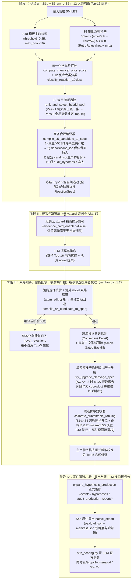

# v44-Next (v1.2) 下一代主干生产架构与管线接线说明书（2026-11-10）

- **状态**：`v44-Next v1.2` 已正式接线至 PPV1 生产管线并通过端到端回归验证
- **基准兼容锚点**：`b220d32`（默认开关关闭时 100% 零漂移，逐字节兼容既有 `S0` 建池与 `A` 臂运行行为）
- **红线声明**：本文档与对应代码 100% 零金标 SMILES、零题面 SMILES、零单题真实 `qid`；判分 100% 零 LLM；所有进入最终导出的事件均经过正规 `ReactionSpec` 编译、RDKit 执行核验与 11 项 `audit_hypothesis` 审计；严守 G1 角色绑定护栏（绝不将 `coproduct` 改写为 `principal_product`）。

---

## 一、架构升级背景与模块设计概览

`v44-Next (v1.2)` 将经实验验证具有显著正收益的五项核心升级正规化合入 PPV1 生产管线：

| 升级维度 | 设计机制与工程改进 | `v44-Next` 生产管线落点 |
|---|---|---|
| **① 移除负收益 `v1card` 证据卡（`ABL-1′`）** | 关闭高噪声候选池上的 `v1card` 局部打分卡片注入，保留底物原子表与化学结构特征，释放模型化学先验排序能力 | `s5b_builder.py` / `runflow.py` / `s5b_cli.py`：`evidence_card_version="none"` / `--no-evidence-card`，在 `--preset v44-next` 下默认关闭 `evidence_card_enabled` |
| **② `S1d + S5-env ∪ S5-rr` 12 大类均衡 Top-16 混合建池** | 解除建池阶段 `S1d` 数量对 `S5` 规则入池的提前截断；同时接入 `S5-env`（`enviPath` 287 + `EAWAG` 49）与基于预构建 `PatternFingerprint` 索引的 `S5-rr`（`RetroRules` `rhea` + `mnx`, $r \in \{2,4,6\}$；在无索引资产的轻量环境中优雅降级为仅 `S5-env`），统一计算 `compute_chemical_prior_score` 与 12 反应大类标签，经 `rank_and_select_hybrid_pool` 12 大类均衡选入 **Top-16 混合候选池** | `services/s5_hybrid_choice.py`（`_enumerate_s5_rr_via_resolver`、`build_s5_hybrid_pool_entries`）与 `pollutant/s5b_builder.py`（`default_pool_provider`） |
| **③ `S5` 规则完备合规编译器（离去共产物推导 + 供体骨架纳入 + 主产物身份锁定）** | 在 `compile_s5_candidate_to_spec` 中依次执行：1) 单底物直编与规则原生共产物集编译；2) `_infer_s5_leaving_coproduct_sets` 基于分子式差值与 MCS 提取离去基团；3) `donor_smiles=cand_iso` 完整供体骨架纳入（支持加氧、水合、还原、甲基化等新增原子反应）；4) 锁定 `spec["product_smiles"] = cand_iso`（防止记录侧 `Uncharger` 形式归一导致离子态主产物身份漂移），并强制通过 `prepare_hypothesis` + `execute_atomtool_expansion` + 11 项 `audit_hypothesis`（`ADMISSION_SUBMITTABLE`）准入校验 | `services/s5_hybrid_choice.py`（`_infer_s5_leaving_coproduct_sets`、`compile_s5_candidate_to_spec`） |
| **④ 双路池外 `novel` 回退编译 + 智能门控尾部回填** | 1) 池外 `novel` 提案支持 `atom_edit` 与 `product_first`（`compile_s5_candidate_to_spec`）双路回退编译，失败提案紧缩剔除不占槽位；2) 跨源独立共识（`consensus_boost`）标记与尾部未满 5 槽时的智能门控确定性回填（`SmartGated_Backfill`） | `pollutant/runflow.py`（`consensus_and_smart_backfill`、`_Driver._run_decide`） |
| **⑤ 候选排序器校准与单反应多产物裂解共产物补齐（`DECISION-9` 方向 3，`v1.2` 新增）** | 1) **单反应多产物裂解伴随产物补齐（`infer_cleavage_coproducts` + `try_upgrade_cleavage_spec`）**：当已准入候选发生碳骨架裂解（$\Delta C \le -2$）且未声明伴随产物时，利用 RDKit 最大公共子结构（MCS）提取断裂离去片段并尝试升级为包含伴随共产物（严格标记为 `role="coproduct"`，严守 G1 护栏不冒充 `principal_product`）的合法 `ReactionSpec`；2) **五层级化学证据排序校准（`calibrate_submittable_ranking`）**：对进入 `submittable` 的候选按可观测结构与共识证据（Tier 0 强模板/跨轨共识首选锁定 $\to$ Tier 1 `S1d ∩ S5` 跨轨产物同构共识升位 $\to$ Tier 2 模型显式选中强 `S1d` 或中强 `S5` 先验候选 $\to$ Tier 3 多源共识回填升位 $\to$ Tier 4 弱相似孤立模板 `0.25 <= sim < 0.50` 降权压后）重排 Top-5，攻克 `rank_rb > 1` 排序折损 | `services/s5_hybrid_choice.py`（`infer_cleavage_coproducts`、`try_upgrade_cleavage_spec`、`calibrate_submittable_ranking`）与 `pollutant/runflow.py`（`consensus_and_smart_backfill`） |

---

## 二、`v44-Next (v1.2)` 四阶段生产管线架构图



---

## 三、核心模块接线细节

### 1. 供给层：[`s5_hybrid_choice.py`](../../src/pathway_v43/services/s5_hybrid_choice.py) 与 [`s5b_builder.py`](../../src/pathway_v43/pollutant/s5b_builder.py)

1. **`build_s5_hybrid_pool_entries` 管线入口**：
   - 接收底物 `substrate_smiles` 与已检索出的 `s1d_specs` 列表，从 `s1d_specs` 提取真实的检索通道集合（`recorded`、`corpus`、`analog`）与最佳 Tanimoto 相似度 `best_similarity`；
   - 运行 `S5-env`（`enviPath` 287 条规则 + `EAWAG` 49 条规则）及 `S5-rr`（优先调用 `_enumerate_s5_rr_via_resolver` 基于 `RetroTemplateResolver.library.search` 子结构检索 `rhea` 与 `mnx` 模板库，$r \in \{2,4,6\}$；若运行环境无 `assets/retrorules/derived/*_retro_index.npz` 则优雅降级，不抛异常）；
   - 通过 `classify_reaction_12class` 标注 12 反应大类，并通过 `compute_chemical_prior_score` 计算多源共识化学先验分；
   - 通过 `rank_and_select_hybrid_pool` 执行两阶段 12 大类均衡选池（Pass 1 每反应大类最多保留 3 条高分候选以保障多酶竞争反应路径覆盖，Pass 2 按全局先验分补齐至 `max_pool=16`）；
   - 将智能门控标记 `is_gated_supplement = (len(annotated_s1d) <= s5_supplement_gate_max_s1d or prior_score >= s5_super_consensus_score)` 写入条目元数据，供下游 `runflow.py` 尾部槽位回填阶段读取。
2. **完备合规编译器（`compile_s5_candidate_to_spec`）**：
   - 先尝试单底物编译及规则原生共产物集编译 `compile_recorded_reaction(sub_iso, sub_iso, [cand_iso, *cop_list], novel_product_first_principal=cand_iso)`；
   - 若因基团脱落/水解/脱卤/加氧/水合/还原/甲基化报 `no_structure_correspondence`、`new_atom_placement_incomplete` 或 `no_alignment`，自动调用 `_infer_s5_leaving_coproduct_sets(sub_iso, cand_iso)` 推导离去共产物，并支持将 `donor_smiles` 设为 `cand_iso`（利用 `compile_recorded_reaction` 完整供体骨架纳入机制提供新增的 O/C/N/S/P 原子）；
   - **主产物身份锁定与 11 项审计准入核验**：显式锁定 `spec["product_smiles"] = cand_iso`（避免记录侧 `Uncharger` 将去质子化羧酸根等离子态产物改写为中性分子），随后执行 `prepare_hypothesis` + `execute_atomtool_expansion` + `audit_hypothesis` + `decide_admission` 全链路核验，仅放行 `disposition in ADMISSION_SUBMITTABLE` 且生成状态含 `strict_identity_of(cand_iso)` 的合规 `ReactionSpec`。

### 2. 决策、共产物升级与排序器校准层：[`runflow.py`](../../src/pathway_v43/pollutant/runflow.py) 与 [`s5_hybrid_choice.py`](../../src/pathway_v43/services/s5_hybrid_choice.py)

1. **去 `v1card` 证据卡预设（`ABL-1′`）**：
   - 当 `preset="v44-next"` 或 `evidence_card_version="none"` 时，`start_ppv1_run` 与 `resume_ppv1_run` 自动将 `evidence_card_enabled` 设为 `False`，保持 `resume_ppv1_run` 的完整冻结计划与身份闭合校验。
2. **双路池外 `novel` 回退编译与智能门控尾部回填（`consensus_and_smart_backfill`）**：
   - **池外 `novel` 双路编译（Dual-Path Novel Compilation）**：在 `_Driver._run_decide` 中，当 `enable_smart_gated_backfill` 启用时，池外 `novel` 提案若 `atom_edit` 预检/编译/执行/审计未通过，自动提取提案中的目标主产物 SMILES 并回退调用 `compile_s5_candidate_to_spec` 编译为合规 `ReactionSpec`；仍失败的提案记入 `novel_rejections` 并紧缩剔除，绝不占用 Top-5 槽位；
   - **智能门控尾部回填（Smart-Gated Backfill）**：当模型显式选中的合法提案不足 `backfill_target_events`（默认 `5`）且满足门控条件时，按 `s5_prior_score` 降序从池内未选候选中挑选门控准入项，使用 `prepared["tool_inputs"]["execution_input_smiles"]` 执行完整 RDKit 展开与 11 项 `audit_hypothesis` 审计，补充候选池。
3. **单反应多产物裂解伴随产物补齐（`infer_cleavage_coproducts` + `try_upgrade_cleavage_spec`）**：
   - 针对酯键/酰胺键/糖苷键/醚键水解、C–N 脱烷基及芳环裂解等单步生成两个主片段的反应，当候选主产物相比底物损失 $\ge 2$ 个碳原子（$\Delta C \le -2$）且 `ReactionSpec.coproducts` 为空时，`infer_cleavage_coproducts` 基于 RDKit MCS 定位底物上断裂脱落的连通片段，构造水合/还原/氧化态伴随产物候选集；
   - `try_upgrade_cleavage_spec` 将推导出的伴随产物填入 `coproducts`（严格保持 `role="coproduct"`，遵守 G1 护栏），重新执行 `compile_recorded_reaction` + `prepare_hypothesis` + `execute_atomtool_expansion` + 11 项 `audit_hypothesis` 核验；若升级版通过 `ADMISSION_SUBMITTABLE`，则无损替换原单产物 `ReactionSpec`，否则安全保留原 `ReactionSpec`。
4. **五层级候选排序器校准（`calibrate_submittable_ranking`）**：
   - 针对 `S1d` 相似度阈值放宽至 `0.25` 后弱相似孤立模板诱饵（`0.25 <= sim < 0.50`）占据 Slot 1 导致金标被压在 Slots 2–5（`rank_rb > 1`）的系统性折损，`calibrate_submittable_ranking` 基于 100% 确定性可观测特征对 `submittable` 候选进行校准重排：
     - **Tier 0（首选锁定）**：若模型第 1 顺位（Rank 1）为高相似模板（`sim >= 0.72` 或 `recorded` 精确命中）、或跨轨产物同构共识（`S1d ∩ S5`）、或多源高先验 `S5`（`n_fam >= 2` 且 `prior >= 115`），则锁定 Slot 1 不被篡位；
     - **Tier 1（跨轨同构共识升位）**：池内 `S1d` 与 `S5` 独立指向同一主产物 `strict_identity_of`（或候选携带 $\ge 2$ 个独立源家族且 `prior >= 120`）的候选优先升至前列；
     - **Tier 2（模型显式选中的中高置信候选）**：模型显式选中的强相似 `S1d`（`sim >= 0.50`）、高先验 `S5`（`prior >= 95`）或合规 `novel` 提案，按模型位次与化学先验综合分排序；
     - **Tier 3（高共识门控回填升位）**：池内未选但具备跨源强共识（`n_fam >= 2` 且 `prior >= 125`）的回填候选可超越弱相似孤立模板；
     - **Tier 4（弱相似孤立模板降权）**：将无 `S5` 共识支撑、单通道且 `0.25 <= sim < 0.50` 的弱相似 `S1d` 模板排至高先验 `S5` 与强共识候选之后，最后按主产物 `strict_identity_of` 严格去重并截取 Top-5。

---

## 四、新增配置开关清单与默认零漂移护栏

所有新增能力均受显式开关控制；**当开关未启用（默认态）时，代码行为与 `b220d32` 100% 逐字节兼容**：

| 所属模块 / CLI | 参数 / 开关名 | 默认值（兼容 `b220d32`） | `--preset v44-next` 下取值 | 作用说明 |
|---|---|---|---|---|
| `s5b_cli.py build` / `s5b_builder.py` | `--preset` / `preset` | `None` | `"v44-next"` | 一键启用 `v44-Next v1.2` 全套供给层与决策层配置 |
| `s5b_cli.py build` / `s5b_builder.py` | `--pool-profile` | `"s0"` (`thr=0.45, max=8`) | `"s1d"` (`thr=0.25, max=16`) | 切换主轨模板检索池配置 |
| `s5b_cli.py build` / `s5b_builder.py` | `--enable-s5-hybrid-pool` / `enable_s5_hybrid_pool` | `False` | `True` | 开启 `S1d + S5-env ∪ S5-rr` 12 大类均衡 Top-16 混合建池与合规编译 |
| `s5b_cli.py build` / `s5b_builder.py` | `s5_include_rr` | `True`（仅在 `enable_s5_hybrid_pool=True` 时生效） | `True` | 启用本地 `RetroRules` (`rhea` + `mnx`, $r \in \{2,4,6\}$) 索引检索，缺资产时自动优雅降级 |
| `s5b_cli.py build` / `s5b_builder.py` | `--s5-supplement-gate-max-s1d` | `2` | `2` | 尾部回填阶段触发 `S5` 常规补槽的主池模板数上限门控 |
| `s5b_cli.py build` / `s5b_builder.py` | `--s5-supplement-min-prior-score` | `70.0` | `70.0` | `S5` 候选最低化学先验分参考阈值 |
| `s5b_cli.py build` / `s5b_builder.py` | `--s5-super-consensus-score` | `115.0` | `115.0` | 跨源超高共识阈值（$\ge 115.0$） |
| `s5b_cli.py build` / `runflow.py` | `--no-evidence-card` / `evidence_card_version` | `False` / `None` | `True` / `"none"` | 关闭负收益 `v1card` 候选证据卡注入（对应 `ABL-1′`） |
| `s5b_cli.py build` / `runflow.py` | `--enable-smart-gated-backfill` / `enable_smart_gated_backfill` | `False` | `True` | 开启池外 `novel` 双路回退编译、跨源共识标注、智能门控尾部回填、单反应多产物裂解共产物升级与五层级候选排序器校准 |

---

## 五、一键运行与验证命令

### 1. 单元测试与端到端管线测试

```bash
PYTHONPATH=src pytest \
    tests/pollutant/test_v44_next_pipeline.py \
    tests/unit/test_s5_hybrid_choice.py -v
```

### 2. 生产管线 `v44-Next` 一键构建、运行与多口径（`v4` / `v5` / `v2`）判分命令

```bash
# Step 1: 使用 --preset v44-next 构建批次（自动启用 S1d + S5-env ∪ S5-rr Top-16 混合建池 + 去 v1card + 智能门控回填与排序器校准）
PYTHONPATH=src python -m pathway_v43.pollutant.s5b_cli build \
    --questions <questions.jsonl> \
    --batch-root <batch_root> \
    --batch-tag <batch_tag> \
    --domain <domain_tag> \
    --preset v44-next \
    --recorded-source

# Step 2: 登记预注册与预算守卫并并发执行
PYTHONPATH=src python -m pathway_v43.pollutant.s5b_cli approve \
    --batch-root <batch_root> \
    --preregistration-id prereg-s5b-2026-10-09 \
    --user-authorization <auth_record>

PYTHONPATH=src python -m pathway_v43.pollutant.s5b_cli budget \
    --batch-root <batch_root> \
    --budget-mode no_monetary_cap_user_decision \
    --user-decision-date YYYY-MM-DD \
    --user-decision-record "<decision_record>"

# Step 3: 零 LLM 官方多口径判分（永久基线 v4 matched_product_hit、严格角色绑定 v5 role_bound_product_hit 与 v2 T1-exempt strict）
PYTHONPATH=src python -m pathway_v43.pollutant.s5b_cli score \
    --batch-root <batch_root> \
    --runs-root <runs_root> \
    --data-scope real
```
