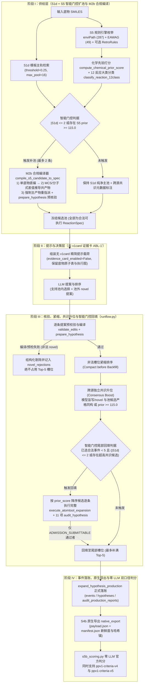

# v44-Next 下一代主干生产架构与管线接线说明书（2026-11-10）

- **状态**：已正式接线至 PPV1 生产管线并通过端到端回归验证
- **基准兼容锚点**：`b220d32`（默认开关关闭时 100% 零漂移，逐字节兼容既有 `S0` 建池与 `A` 臂运行行为）
- **红线声明**：本文档与对应代码零金标 SMILES、零题面 SMILES、零单题真实 `qid`、不报告任何评测成绩数字；判分零 LLM；所有进入最终导出的事件均经过正规 `ReactionSpec` 编译、RDKit 执行核验与 11 项 `audit_hypothesis` 审计。

---

## 一、架构升级背景与机制对应关系

`v44-Next` 架构基于前序架构方案对比（[`LLM_PLACEMENT_OPTIONS_2026-11-05.md`](./LLM_PLACEMENT_OPTIONS_2026-11-05.md)）、模块消融分析与候选池覆盖机制审计，将三项核心机制升级正规化合入 PPV1 生产管线，并针对合规审计发现的编译折损与槽位浪费问题完成了两项工程加固：

| 升级维度 | 对应方案 / 机制依据 | 核心定性结论 | `v44-Next` 生产管线落点 |
|---|---|---|---|
| **① 移除负收益 `v1card` 证据卡** | `ABL-1′`（去证据卡消融机制） | `v1card` 在高噪声候选池上易诱导模型过度关注局部打分细节而抑制化学机理判断；关闭证据卡可释放模型化学先验排序能力 | `s5b_builder.py` / `runflow.py` / `s5b_cli.py`：`evidence_card_version="none"` / `--no-evidence-card`，默认在 `--preset v44-next` 下自动关闭 `evidence_card_enabled` |
| **② `S1d + S5` 智能门控扩池与化学先验排序** | `S1d` 冻结扩池 + `S5`（enviPath + EAWAG + RetroRules）双轨门控 | 同步拓展通用酶学与环境降解路径的候选召回边界，同时通过稀疏池门控与跨源共识阈值避免无门控全放开带来的信噪比退化 | `services/s5_hybrid_choice.py`（`build_s5_hybrid_pool_entries` + `compile_s5_candidate_to_spec`）与 `s5b_builder.py`（`s1d_pool_provider`） |
| **③ `S5` 候选离去基团/共产物自动推导编译（M2a → M2b 加固）** | `S1d+S5` 合规编译审计工程加固 | 单底物无共产物直编在加氧、脱卤、水解及基团转移反应上易因缺省离去组分导致原子守恒与映射失败（`no_structure_correspondence`）；引入 `_infer_s5_leaving_coproduct_sets`（基于分子式差值与 MCS 离去片段提取 + 主产物重指派）后，可系统性挽回此类因离去基团缺失导致的编译损耗 | `services/s5_hybrid_choice.py`（`_infer_s5_leaving_coproduct_sets`、`compile_s5_candidate_to_spec`） |
| **④ 跨源共识升位 + 非法槽位紧缩 + 智能门控尾部回填** | `LLM_PLACEMENT_OPTIONS_2026-11-05.md` 方案演进 + `SmartGated_Backfill` | 模型自由生成的池外 B 类 novel 提案常因原子守恒或映射失败无法通过编译与 11 项审计；先对已通过核验与审计的合法提案做紧缩排序（Compact before Backfill），再将跨源共识候选升位保位，并对未满 5 槽的尾部空位用高先验已核验池事件确定性补齐 | `pollutant/runflow.py`（`consensus_and_smart_backfill` 接入 `_Driver._run_decide`） |

---

## 二、`v44-Next` 四阶段生产管线架构图



---

## 三、核心模块接线细节

### 1. 供给层：[`s5_hybrid_choice.py`](../../src/pathway_v43/services/s5_hybrid_choice.py) 与 [`s5b_builder.py`](../../src/pathway_v43/pollutant/s5b_builder.py)

1. **`build_s5_hybrid_pool_entries` 管线入口**：
   - 接收底物 `substrate_smiles` 与已检索出的 `s1d_specs` 列表；
   - 运行 `S5-env`（`enviPath` 287 条规则 + `EAWAG` 49 条规则，带反应物 SMARTS 子结构预筛与原子映射清理 `_strip_atom_maps`）及可选 `S5-rr`（RetroRules）；
   - 通过 `classify_reaction_12class` 标注 12 反应大类，并通过 `compute_chemical_prior_score` 计算多源共识化学先验分（`HIGH_CONSENSUS >= 115.0`、`MODERATE_SINGLE >= 70.0`）；
   - 若池内已有候选与 `S5` 规则产出同一严格结构身份（`strict_identity_of`），直接将 `s5_prior_score`、`s5_prior_tier`、`reaction_class_12`、`source_families` 原地赋能给既有 `S1d` 条目；
   - **智能门控触发条件**：当主池 `S1d` 模板数 $\le$ `s5_supplement_gate_max_s1d`（默认 `2`），或存在 `prior_score >= s5_super_consensus_score`（默认 `115.0`）的跨源强共识候选时，准入最多 `s5_max_supplements`（默认 `2`）条 `S5` 候选进入编译。
2. **M2a → M2b 离去基团/共产物自动推导编译（`compile_s5_candidate_to_spec`）**：
   - 先尝试单底物无共产物编译 `compile_recorded_reaction(sub, sub, [cand_iso], novel_product_first_principal=cand_iso)`；
   - 若因基团脱落/水解/脱卤/脱羧报 `no_structure_correspondence` 或原子映射失败，自动调用 `_infer_s5_leaving_coproduct_sets(sub_iso, cand_iso)`：
     - 基于底物与候选产物的重原子分子式差值（$\Delta\text{C}, \Delta\text{N}, \Delta\text{O}, \Delta\text{S}, \Delta\text{P}, \Delta\text{Halogen}$）与 `rdFMCS.FindMCS` 离去骨架提取，自动生成候选离去共产物集合（如 `Cl`、`Br`、`O`、`O=C=O`、`N`、`CC=O`、`CC(=O)O` 等）；
     - 依次传入 `compile_recorded_reaction(sub_iso, sub_iso, [cand_iso, *coproducts], novel_product_first_principal=cand_iso)` 重试编译；
   - **主产物重指派与可执行预核验**：若 `compile_recorded_reaction` 选出的默认主产物与 `cand_iso` 不同，自动将原主产物移入 `coproducts` 并把 `spec["product_smiles"]` 重指派为 `cand_iso`；随后立即执行一次无副作用的 `prepare_hypothesis` + `execute_atomtool_expansion` 预核验，确保入池的每一条 `S5` 补充条目 100% 具备合法的 `edits`、原子映射与参与物账目。

### 2. 决策与核验层：[`runflow.py`](../../src/pathway_v43/pollutant/runflow.py)

1. **去 `v1card` 证据卡预设（`ABL-1′`）**：
   - 当 `preset="v44-next"` 或 `evidence_card_version="none"` 时，`start_ppv1_run` 与 `resume_ppv1_run` 自动将 `evidence_card_enabled` 设为 `False`，且不向策略身份块写入 `v1card` 字段；
   - 保持 `resume_ppv1_run` 的完整冻结计划与身份闭合校验。
2. **紧缩、共识升位与智能门控尾部回填（`consensus_and_smart_backfill`）**：
   - **非法 B 类槽位紧缩（Compact before Backfill）**：在 `_Driver._run_decide` 中，所有模型提出的池外 novel 提案先经过 `_validate_edits` 与 `prepare_hypothesis`；失败提案记入 `novel_rejections` 并直接跳过，仅已通过预校验的合法条目进入 `prepared_entries` 参与排序，绝不让非法提案占据 Top-5 槽位；
   - **跨源独立共识升位（Consensus Boost）**：当某条候选同时被模型盲写/novel 提案与候选池规则独立命中（`strict_identity_of` 相同），或其 `s5_prior_score >= s5_super_consensus_score`（跨 $\ge 2$ 独立源共识）时，标记 `consensus_boost=True`，在同优先级梯队内优先保位；
   - **智能门控尾部回填（Smart-Gated Backfill）**：当模型显式选择的合法提案不足 `backfill_target_events`（默认 `5`）且满足门控条件（`S1d` 模板数 $\le 2$、模型显式选择 $< 3$ 条或池中存在 $\ge 115.0$ 超高共识未选候选）时，对尚未入选的池内高先验候选逐一在决定层预执行 `prepare_hypothesis` + `execute_atomtool_expansion` + `audit_hypothesis` + `decide_admission`：
     - **只有 `disposition in ADMISSION_SUBMITTABLE`（即通过 11 项化学审计）的候选才允许回填**；
     - 回填条目排在模型显式选择的合法提案之后（保留模型主推 Slots 1..k），并在后续 `expand_hypothesis` 动作中走完全相同的正式生产与落账链路。

---

## 四、新增配置开关清单与默认零漂移护栏

所有新增能力均受显式开关控制；**当开关未启用（默认态）时，代码行为与 `b220d32` 100% 逐字节兼容**：

| 所属模块 / CLI | 参数 / 开关名 | 默认值（兼容 `b220d32`） | `--preset v44-next` 下取值 | 作用说明 |
|---|---|---|---|---|
| `s5b_cli.py build` / `s5b_builder.py` | `--preset` / `preset` | `None` | `"v44-next"` | 一键启用 `v44-Next` 全套供给层与决策层配置 |
| `s5b_cli.py build` / `s5b_builder.py` | `--pool-profile` | `"s0"` (`thr=0.45, max=8`) | `"s1d"` (`thr=0.25, max=16`) | 切换主轨模板检索池配置 |
| `s5b_cli.py build` / `s5b_builder.py` | `--enable-s5-hybrid-pool` / `enable_s5_hybrid_pool` | `False` | `True` | 开启 `S5`（enviPath + EAWAG + 可选 RetroRules）规则枚举与 M2b 编译入池 |
| `s5b_cli.py build` / `s5b_builder.py` | `--s5-supplement-gate-max-s1d` | `2` | `2` | 触发 `S5` 常规补池的主池模板数上限门控（$\le 2$ 时补池） |
| `s5b_cli.py build` / `s5b_builder.py` | `--s5-supplement-min-prior-score` | `70.0` | `70.0` | `S5` 常规补池最低化学先验分阈值 |
| `s5b_cli.py build` / `s5b_builder.py` | `--s5-super-consensus-score` | `115.0` | `115.0` | 跨源超高共识突破门控阈值（$\ge 115.0$ 时不受 `max_s1d` 限制） |
| `s5b_cli.py build` / `s5b_builder.py` | `--s5-max-supplements` | `2` | `2` | 每道题最多补充的 `S5` 预编译规则候选条数 |
| `s5b_cli.py build` / `runflow.py` | `--no-evidence-card` / `evidence_card_version` | `False` / `None` | `True` / `"none"` | 关闭负收益 `v1card` 候选证据卡注入（对应 `ABL-1′`） |
| `s5b_cli.py build` / `runflow.py` | `--enable-smart-gated-backfill` / `enable_smart_gated_backfill` | `False` | `True` | 开启跨源共识升位、非法槽位紧缩与智能门控尾部回填 |

---

## 五、一键运行与验证命令

### 1. 单元测试与端到端管线测试

```bash
PYTHONPATH=src python -m pytest \
    tests/pollutant/test_v44_next_pipeline.py \
    tests/unit/test_s5_hybrid_choice.py -v
```

### 2. 生产管线 `v44-Next` 一键构建、运行与双口径（`v4` / `v5`）判分命令

```bash
# Step 1: 使用 --preset v44-next 构建批次（自动启用 S1d + S5 门控扩池 + M2b 编译 + 去 v1card + 智能门控回填配置）
PYTHONPATH=src python -m pathway_v43.pollutant.s5b_cli build \
    --questions <questions.jsonl> \
    --batch-root <batch_root> \
    --batch-tag <batch_tag> \
    --domain 298 \
    --preset v44-next

# Step 2: 登记预注册与预算守卫并并发执行
PYTHONPATH=src python -m pathway_v43.pollutant.s5b_cli approve \
    --batch-root <batch_root> \
    --preregistration-id prereg-s5b-2026-10-09

PYTHONPATH=src python -m pathway_v43.pollutant.s5b_cli budget \
    --batch-root <batch_root> \
    --budget-mode no_monetary_cap_user_decision

PYTHONPATH=src python -m pathway_v43.pollutant.s5b_cli run \
    --batch-root <batch_root> \
    --runs-root <runs_root> \
    --workers 40

# Step 3: 零 LLM 官方双口径判分（永久基线 v4 matched_product_hit 与严格角色绑定 v5 role_bound_product_hit）
PYTHONPATH=src python -m pathway_v43.pollutant.s5b_cli score \
    --batch-root <batch_root> \
    --runs-root <runs_root> \
    --domain 298 \
    --criteria-version ppv1-criteria-v4

PYTHONPATH=src python -m pathway_v43.pollutant.s5b_cli score \
    --batch-root <batch_root> \
    --runs-root <runs_root> \
    --domain 298 \
    --criteria-version ppv1-criteria-v5
```
